# Fase de Diseño — planificación, arquitectura, componentes y experiencia de usuario

**Sistema de Gestión del Asilo de Ancianos Cabeza de Algodón** · Proyecto final de Análisis y Diseño de Sistemas II · Universidad Mariano Gálvez de Guatemala, Centro Universitario de Mazatenango
Brandon Joaquín García Suy · carné 3090-23-12053 · versión 1.0, 27 de septiembre de 2026

Este documento responde a los cuatro entregables de la Fase de Diseño del enunciado:

1. **Planificación del trabajo**: procesos, avances, recursos y tiempo de dedicación.
2. **Arquitectura**: estilo arquitectónico y forma de acceso público (nube o servidor propio).
3. **Componentes de software**: documentados y diseñados en clases.
4. **Experiencia de usuario**: patrones, diseño del sistema y clases de interfaz del frontend y del backend.

No parte de cero. Se apoya en lo que ya existe y lo cita:

| Fuente | Qué aporta |
|---|---|
| Fase de Análisis (`Diseño proyecto Asilo.pdf`) | RF-01 a RF-21, RNF-01 a RNF-06, casos de uso CU-001 a CU-006, secuencias DS-01 a DS-03, estados DE-01 a DE-04, diagrama de clases y ERD |
| Jira, proyecto [YS](https://joaquingsuy93.atlassian.net/browse/YS-1) | Backlog: 8 épicas, historias (HU) con puntos y criterios de aceptación, subtareas, sprints |
| Figma, archivo [UI Sprint 1](https://www.figma.com/design/Gzjti6A7pPPGwESzZLVR5u) | Prototipos de pantallas y sistema de diseño |
| Manual de Diseño Visual v1.1 | Colores, tipografía, espaciado, componentes y menús por rol |
| [docs/seguridad.md](seguridad.md) | Decisiones de seguridad ya implementadas (contraseñas, JWT, RBAC) |
| Código del repositorio (etiqueta `v0.1.0` y rama `develop`) | Módulo de acceso y usuarios terminado en el Sprint 1 |

Cuando el diseño cambia algo definido en el análisis, se indica el cambio y su motivo.

**Contenido:** 1. Planificación del trabajo · 2. Arquitectura · 3. Componentes de software · 4. Experiencia de usuario · 5. Hallazgos que afectan el backlog

---

## 1. Planificación del trabajo

### 1.1 Metodología y herramienta de gestión

El proyecto se gestiona con **Scrum adaptado a un equipo de una persona**. La herramienta es **Jira Software** (proyecto YS), que el enunciado admite como alternativa a Microsoft Project ("cualquier otra herramienta para gestión de proyectos de software"). Se eligió Jira porque:

- **El plan cambia cada semana y Jira lo absorbe sin rehacer el cronograma.** El Sprint 1 incorporó 13 subtareas y 2 historias que no estaban en el backlog original (sección 1.4). En un Gantt de Project cada cambio obliga a replanificar dependencias a mano; en Jira entra al backlog, se prioriza y aparece en el siguiente sprint.
- **Une el plan con el código.** Cada rama se llama `caracteristica/YS-<número>-<descripción>` y cada commit cita su subtarea, así que cualquier línea de código se rastrea hasta su historia de usuario y, desde ella, hasta el requerimiento funcional (RF) que la originó.
- **Mide con datos reales.** La velocidad, el avance del sprint y el registro de horas salen del tablero, no de estimaciones hechas al final.

Para quien prefiera ver el plan como línea de tiempo, la sección 1.6 presenta los mismos datos en un diagrama de Gantt.

**Jerarquía del backlog:** Épica → Historia de usuario (HU, estimada en *story points*) → Subtareas técnicas etiquetadas `[Backend]`, `[Frontend]` y `[Pruebas]`. Una historia solo se considera terminada cuando lo están sus tres tipos de subtarea.

**Ceremonias adaptadas.** Con una sola persona no tiene sentido una reunión diaria. Se conserva el propósito de cada ceremonia:

| Ceremonia | Cuándo | Qué se hace |
|---|---|---|
| Planificación del sprint | Lunes, al abrir el sprint | Elegir las HU según la capacidad en horas (1.3), crear sus subtareas y hacer en Figma el prototipo de las pantallas del sprint |
| Seguimiento diario | Al empezar cada sesión de trabajo | Mover las subtareas en el tablero y registrar las horas trabajadas en Jira (*Registro de trabajo*) |
| Revisión del sprint | Domingo, al cerrar el sprint | Demostrar cada HU contra sus criterios de aceptación, fusionar `develop` en `main` y etiquetar la versión |
| Retrospectiva | Domingo, después de la revisión | Comparar lo estimado con lo real y ajustar el siguiente sprint; se anota en la descripción del sprint en Jira |

**Definición de terminado (DoD).** Una subtarea pasa a *Listo* solo si:

1. Cumple los criterios de aceptación de su HU en Jira.
2. Las pruebas del backend pasan (`./mvnw test`, con PostgreSQL real vía Testcontainers).
3. El frontend pasa el analizador estático (`npm run lint`).
4. Las pantallas nuevas se revisaron a 375, 768, 1024 y 1280 px (HU-33) y respetan el Manual de Diseño Visual.
5. Todo endpoint nuevo declara qué roles lo usan y tiene una prueba que confirma que los demás roles reciben 403.
6. Si la subtarea toma una decisión de seguridad, esta queda documentada en `docs/seguridad.md`.
7. La rama de la historia se fusionó en `develop` con `--no-ff`.

**Duración de los sprints.** El Sprint 1 duró tres semanas. **Desde el Sprint 2 los sprints duran una semana**, porque solo quedan 19 días hasta la entrega del 16 de octubre. Con sprints de tres semanas habría una única revisión antes de entregar, demasiado tarde para corregir el rumbo.

**Versionado.** Se usa git-flow: `develop` integra las historias terminadas y `main` solo recibe fusiones etiquetadas. Las etiquetas hasta ahora son `v0.1.0` y `v0.1.1` (Sprint 1) y `v0.1.2` (HU-32, el 08/10); quedan `v0.2.0` al cerrar el Sprint 2 y `v1.0.0` en la entrega. La correspondencia es con el trabajo entregado y no estrictamente con el sprint: `v0.1.1` y `v0.1.2` recogen historias terminadas fuera de la ventana de su sprint, que es lo que de verdad ocurrió.

### 1.2 Recursos

**Recursos humanos**

| Rol Scrum | Responsable | Dedicación |
|---|---|---|
| Product Owner (prioriza el backlog) | Brandon Joaquín García Suy | Incluida en las 20 h semanales |
| Scrum Master (proceso y seguimiento) | Brandon Joaquín García Suy | Incluida |
| Desarrollador full-stack (backend, frontend, base de datos) | Brandon Joaquín García Suy | Incluida |
| Pruebas y aseguramiento de calidad | Brandon Joaquín García Suy | Incluida |
| Cliente y evaluador | Ing. Ángel Atilio Maltez C. (catedrático) | Revisión en cada entrega de fase |

Los usuarios finales (los siete roles del sistema) no participan directamente. Están representados por los perfiles de uso de la sección 4.1, construidos a partir del enunciado y de los casos de uso.

**Hardware**

| Recurso | Uso |
|---|---|
| Computadora personal (Windows 11, Docker Desktop) | Desarrollo y pruebas locales; ejecuta PostgreSQL en contenedor y las pruebas con Testcontainers |
| Servidor virtual en la nube (sección 2.5) | Producción con acceso público |
| Navegador con emulación de dispositivos | Revisión de las pantallas en teléfono (375 px), tableta (768 px), laptop (1024 px) y escritorio (1280 px) |

**Software**

| Herramienta | Uso | Licencia / costo |
|---|---|---|
| Java 21 (Eclipse Temurin) y Maven (wrapper incluido) | Compilación y ejecución del backend | Libre |
| Spring Boot 4.1: Web, Data JPA, Security, Validation; jjwt 0.13; Lombok | Backend | Libre |
| Node.js, Vite 8, React 19, React Router 7, Tailwind CSS 4, Axios, lucide-react | Frontend | Libre |
| PostgreSQL 15 | Base de datos | Libre |
| Docker y Docker Compose | Entornos de desarrollo y producción | Gratuito para uso personal y educativo |
| JUnit 5 y Testcontainers | Pruebas automatizadas del backend | Libre |
| oxlint | Análisis estático del frontend | Libre |
| Visual Studio Code | Editor | Gratuito |
| Git y GitHub | Control de versiones | Gratuito |
| Jira Software (plan Free) | Gestión del proyecto | Gratuito hasta 10 usuarios |
| Notion (plan Free) | Checklist de fases y backlog priorizado | Gratuito |
| Figma (plan Starter) | Prototipos y sistema de diseño | Gratuito |
| Caddy 2 y Let's Encrypt | Servidor web y certificado HTTPS en producción | Libre |

**Servicios de infraestructura (costo mensual)**

| Servicio | Proveedor elegido | Costo |
|---|---|---|
| Servidor virtual | Oracle Cloud, nivel *Always Free* (máquina Ampere A1, ARM) | US$ 0 |
| Nombre de dominio | Subdominio gratuito (DuckDNS). Un dominio propio es opcional para una puesta en producción real | US$ 0 (dominio propio: ~US$ 10–15 al año) |
| Certificado TLS | Let's Encrypt, renovado automáticamente por Caddy | US$ 0 |
| Almacenamiento de respaldos | Object Storage de Oracle Cloud (20 GB en el nivel gratuito) | US$ 0 |
| Monitoreo de disponibilidad | UptimeRobot (plan gratuito, revisión cada 5 min) | US$ 0 |
| **Total** | | **US$ 0 al mes** |

Los límites del nivel gratuito se verifican al crear la cuenta. Si Oracle no tiene capacidad ARM disponible en la región (ocurre con frecuencia), la alternativa es un servidor virtual de pago de 2 vCPU y 4 GB de RAM, que cuesta entre US$ 5 y 12 al mes según el proveedor. El resto de la arquitectura no cambia.

### 1.3 Dedicación y capacidad

Al 8 de octubre quedan **128 puntos** —las 24 historias pendientes de las épicas 1 a 7— y **ocho días** hasta la entrega del viernes 16. Son 16 puntos por día; el Sprint 1 rindió 0,65.

La dedicación comprometida al inicio del proyecto, 20 horas semanales, no alcanza para ese volumen. **El plan supone dedicación a tiempo completo durante los ocho días**, y aun así depende de dos condiciones que se explican en 1.5.1 y 1.7: que las historias reutilicen los patrones ya construidos, y que, si un punto de control muestra atraso, se baje el nivel de detalle de lo que falta.

| Actividad | Sprint 2 (08/10–11/10) | Sprint 3 (12/10–15/10) |
|---|---|---|
| Historias (backend, frontend y pruebas) | HU-01 a HU-10, 49 puntos | HU-11 a HU-28, 79 puntos |
| Infraestructura y despliegue | Preparación del servidor, en paralelo | Despliegue el 15/10 |
| Documentación | — | Manual de usuario y documentación de la Fase de Implementación, el 15/10 |
| Ceremonias Scrum | Revisión y retrospectiva el 11/10 | Revisión y retrospectiva el 15/10 |

Los prototipos en Figma salen de la tabla: las pantallas que faltan reutilizan los componentes y los patrones ya construidos (tabla, modal, formulario, estado vacío), así que se diseñan directamente en código.

**Registro de horas.** Desde el Sprint 2, cada subtarea registra en Jira el tiempo trabajado. El Sprint 1 no tiene ese registro y por eso su velocidad solo puede medirse en puntos (1.4). Con el registro, la retrospectiva de cada sprint puede comparar las horas reales con las planificadas.

### 1.4 Estado real al cierre del Sprint 1

| | |
|---|---|
| Fechas | 4 al 26 de septiembre de 2026 (23 días) |
| Objetivo | "Cualquier usuario puede iniciar sesión según su rol, y se puede registrar y consultar el historial de un interno" |
| Resultado | Primera mitad cumplida: HU-29, HU-30, HU-31 y HU-33 terminadas (Épica 8). La segunda mitad (HU-01 y HU-02) no se inició y pasa al Sprint 2 |
| Puntos terminados | 15 de los estimados (HU-33 no tenía estimación) |
| Subtareas terminadas | 27 de 41 |
| Versión | `v0.1.0` (24/09). HU-31 y HU-33 se terminaron después de esa etiqueta y entran en `main` como `v0.1.1` |

La mitad incumplida tiene una causa concreta. **El módulo de acceso fue más grande de lo estimado**: durante el sprint se agregaron 13 subtareas y 2 historias que no estaban en el backlog original, entre ellas:

- cerrar sesión invalidando el token;
- cambiar y restablecer contraseñas;
- avisar cuando la sesión termina;
- mostrar el menú según el rol;
- usar el sistema desde tableta y teléfono.

Se priorizaron porque todos los módulos posteriores se construyen sobre la autenticación y sobre el esqueleto de navegación. Corregir esas bases con dos pantallas construidas cuesta mucho menos que con diez.

**Backlog pendiente**

| Épica | Historias | Requerimientos | Puntos |
|---|---|---|---:|
| 1 · Gestión de internos e historial médico | HU-01, HU-02 | RF-01, RF-02 | 13 |
| 2 · Referencias y asignación de citas | HU-03 a HU-06 | RF-03, RF-04, RF-05 | 16 |
| 3 · Atención médica especializada | HU-07 a HU-11 | RF-06, RF-07, RF-08, RF-10 | 25 |
| 4 · Laboratorio | HU-12 a HU-14 | RF-08, RF-09 | 11 |
| 5 · Farmacia | HU-15 a HU-17 | RF-11 | 11 |
| 6 · Gestión financiera | HU-18 a HU-23 | RF-12 a RF-16 | 27 |
| 7 · Reportes | HU-24 a HU-28 | RF-17 a RF-21 | 25 |
| 8 · Autenticación y gestión de usuarios | HU-32 (contraseña temporal obligatoria) | RNF-03 | sin estimar |
| **Pendiente** | | | **128** |

**El alcance de la entrega son los 21 requerimientos funcionales** de `requerimientos-del-sistema.md`, porque la entrega se evalúa contra ellos. El informe de avance del Sprint 1 definía un producto mínimo viable de 86 puntos que dejaba fuera HU-04 y de HU-20 a HU-28; ese recorte se descartó, porque esas historias son las que cubren el RF-04 y del RF-13 al RF-21. La correspondencia completa entre requerimientos e historias está en `trazabilidad-requerimientos.md`.

### 1.5 Plan de sprints

> **Re-planificado el 8 de octubre de 2026.** El plan original se incumplió. El alcance no cambia —los 21 requerimientos funcionales—; cambian la fecha de cada historia y, si hace falta, el nivel de detalle con que se construye. El porqué está en 1.5.1; el plan original queda en 1.5.2 para poder comparar.

| Sprint | Fechas | Objetivo del sprint | Historias | Puntos | Otras tareas | Versión |
|---|---|---|---|---:|---|---|
| **2** | 08/10 – 11/10 | Un interno recorre el flujo clínico completo: se registra, el médico general lo refiere a una especialidad con un enfermero acompañante, la fundación le asigna cita y el familiar se entera por correo, el especialista lo atiende y le receta, y su historial reúne lo ocurrido. | HU-01 a HU-10 | 49 | Preparación del servidor | `v0.2.0` (11/10) |
| **3** | 12/10 – 15/10 | El laboratorio y la farmacia atienden lo que ordenó el especialista, sus costos llegan a la cuenta del familiar, y la administración lleva sus finanzas y consulta los reportes. | HU-11 a HU-28 | 79 | Despliegue; prueba en Safari; manual de usuario; pruebas de regresión | `v1.0.0` (15/10) |

**Plan día por día**

| Fecha | Historias | Requerimientos | Puntos |
|---|---|---|---:|
| Jue 08 – Vie 09 | HU-01 Perfil del interno. El backend quedó terminado el 08/10; faltan las pantallas | RF-01 | 5 |
| Vie 09 – Sáb 10 | HU-03 Solicitud de referencia, HU-04 Correo al familiar, HU-05 Bandeja de solicitudes, HU-06 Asignación de cita | RF-03, RF-04, RF-05 | 16 |
| Sáb 10 – Dom 11 | HU-07 Visita médica, HU-08 Historial durante la consulta, HU-09 Diagnóstico, HU-10 Receta | RF-06, RF-07, RF-10 | 20 |
| Dom 11 | HU-02 Historial médico centralizado | RF-02 | 8 |
| Lun 12 | HU-11 Orden de exámenes, HU-12 Órdenes de laboratorio, HU-13 Resultados, HU-14 Costo del laboratorio | RF-08, RF-09 | 16 |
| Lun 12 – Mar 13 | HU-15 a HU-17 Farmacia, HU-18 Cuenta del familiar, HU-19 Descuentos | RF-11, RF-12 | 24 |
| Mar 13 | HU-20 Cuentas por pagar, HU-21 Servicios pendientes, HU-22 Donaciones, HU-23 Gastos operativos | RF-13 a RF-16 | 14 |
| Mié 14 | HU-24 a HU-28 Reportes | RF-17 a RF-21 | 25 |
| Jue 15 | Despliegue, prueba en Safari, medición de tiempos de respuesta, manual de usuario, pruebas de regresión | RNF-01, RNF-05, RNF-06 | — |
| Vie 16 | Entrega | | |

**Por qué este orden.** Las historias siguen el recorrido del paciente de los diagramas DS-01 → DS-02 → DS-03. Cada historia consume datos que produce la anterior: no hay visita sin cita, ni resultado sin orden, ni cobro sin costo registrado. Construirlas en ese orden deja, al final de cada día, un tramo del flujo que funciona de punta a punta y se puede demostrar. Los reportes van al final porque solo leen lo que registran los demás módulos.

**El historial centralizado (HU-02) va después de la visita**, y no junto al perfil del interno como en el plan original. El RF-02 pide consolidar visitas, diagnósticos y padecimientos, y las visitas y los diagnósticos los produce el RF-06. Construido antes, el historial solo habría podido mostrar la ficha médica.

**Alcance del diseño.** Las secciones 3 y 4 detallan el diseño del flujo principal, del registro del interno al cobro al familiar. Los módulos restantes —notificaciones, cuentas por pagar, donaciones, gastos y reportes— son registros y consultas sobre ese mismo modelo; su diseño (entidades, endpoints y roles) está en las subtareas de Jira de cada historia.

#### 1.5.1 Por qué se re-planificó

**El plan original se incumplió.** Al 8 de octubre solo se había cerrado HU-32 de las seis historias del Sprint 2, y quedaban 128 puntos y 8 días. La velocidad medida en el Sprint 1 fue de 15 puntos en 23 días, es decir **0,65 puntos por día**.

**Un primer re-plan, ese mismo día, recortaba el alcance, y se descartó.** Pasaba las épicas 3 a 7 a una versión posterior a la entrega y dejaba 26 puntos: el perfil del interno, el historial, la referencia y la asignación de cita. Cuadraba con el calendario, pero cubría 4 de los 21 requerimientos funcionales, y la entrega se evalúa contra los 21. Un requerimiento sin implementar no se cumple por bien que esté el resto: recortar el alcance no resolvía el problema, lo trasladaba a la evaluación.

**Qué se ajusta en su lugar.** El orden de las historias y, si hace falta, su nivel de detalle. Cada historia tiene una versión completa, la que describen sus subtareas en Jira, y una versión simplificada que sigue cumpliendo sus criterios de aceptación y el requerimiento que la origina (1.7, Nivel 1). Se construye la completa mientras el calendario lo permita; si un punto de control muestra atraso, lo que falta pasa a la simplificada. Ninguna historia sale de la entrega.

Lo que **no** se simplifica en ningún caso es la validación del lado del servidor ni las pruebas automatizadas: son lo que distingue un sistema de una maqueta, y es lo que el Sprint 1 demostró que detecta los errores a tiempo.

#### 1.5.2 Plan original, para comparación

| Sprint | Fechas | Historias | Puntos | Versión |
|---|---|---|---:|---|
| 2 | 28/09 – 04/10 | HU-32, HU-01, HU-02, HU-03, HU-05, HU-06 | 26 + HU-32 | `v0.2.0` |
| 3 | 05/10 – 11/10 | HU-07 a HU-14 | 36 | `v0.3.0` |
| 4 | 12/10 – 16/10 | HU-15 a HU-19 | 24 | `v1.0.0` (15/10) |
| 1.1 | Sin fecha | HU-04, HU-20 a HU-28 | 42 | `v1.1.0` |

De ese plan, al 8 de octubre solo se había cumplido HU-32, entregada en `v0.1.2`. El plan original además dejaba fuera de la entrega HU-04 y de HU-20 a HU-28, es decir, el RF-04 y del RF-13 al RF-21; el plan actual los incluye.

**El despliegue.** Estaba previsto para el Sprint 2 y no se hizo. En el plan actual el servidor se prepara en paralelo durante el Sprint 2 y el 15/10 solo se sube la versión final. Los imprevistos de infraestructura (DNS, certificados, imágenes ARM, memoria del servidor) son los que más conviene descubrir con margen: por eso preparar el servidor no espera al último día, aunque la subida final sí.

### 1.6 Cronograma

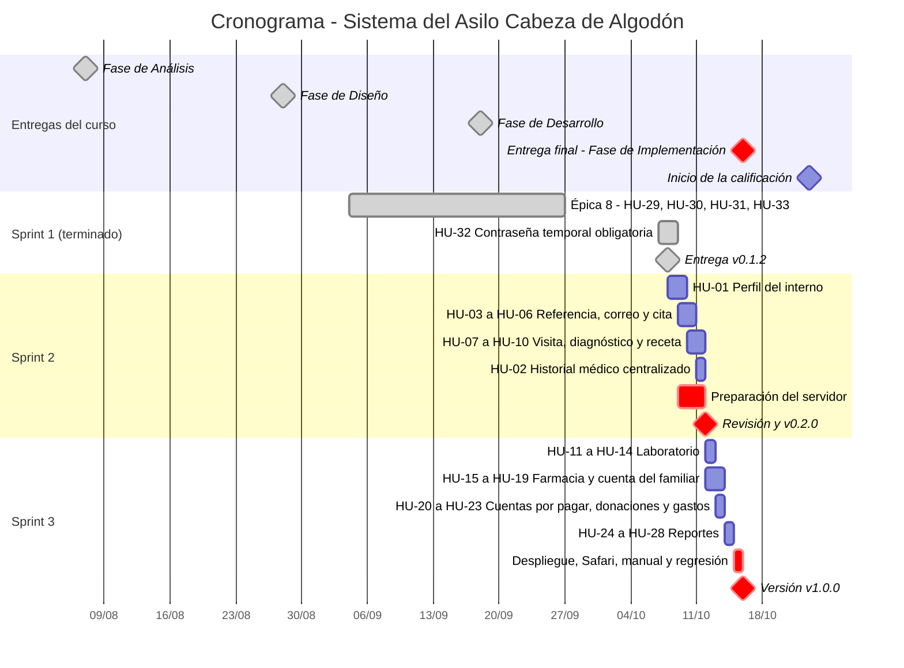

El cronograma refleja el plan re-planificado del 8 de octubre: las 24 historias pendientes, en el orden del recorrido del paciente (1.5).

### 1.7 Riesgos y plan de contingencia

**El riesgo principal es la velocidad, y conviene decirlo con números:**

| | Velocidad |
|---|---:|
| Observada en el Sprint 1 (15 puntos en 23 días) | ~4.6 puntos por semana |
| Necesaria para el plan original (86 puntos en 19 días) | ~32 puntos por semana |
| Necesaria para el plan actual (128 puntos en 8 días) | ~112 puntos por semana |

Medido en subtareas, que es como se registra el avance diario: el Sprint 1 cerró 27 en 23 días, algo más de una por día. Entre el 7 y el 8 de octubre se cerraron seis —HU-32 completa y el backend de HU-01—, tres por día. El plan actual pide cerrar las 91 subtareas pendientes en siete días, unas trece por día: **cuatro veces el ritmo más reciente**. Es un plan de alto riesgo, y se presenta como tal. Lo que lo sostiene:

- **La base ya está hecha.** El Sprint 1 construyó la infraestructura que las historias restantes reutilizan: seguridad y roles, manejo uniforme de errores, esqueleto de navegación, biblioteca de componentes y la base de pruebas con PostgreSQL real.
- **El ritmo ya subió.** Las seis subtareas del 7 y 8 de octubre se cerraron con sus pruebas automatizadas, sobre esa base.
- **Las historias restantes son homogéneas.** Casi todas repiten un mismo patrón ya probado: entidad, servicio, controlador y pantalla. Las de las épicas 6 y 7 son además registros y consultas sin flujo de estados complejo.

Aun así, el plan supone una velocidad que todavía no se ha sostenido. Por eso se trata como riesgo, con puntos de control y contingencias definidas de antemano.

**Puntos de control**

- **Domingo 11 de octubre (revisión del Sprint 2).** HU-01 a HU-10 cerradas. Si no lo están, el Nivel 1 se aplica desde ese momento a todas las historias del Sprint 3, sin esperar a que el atraso crezca.
- **Martes 13 de octubre, al cierre del día.** Laboratorio, farmacia y cuenta del familiar (HU-11 a HU-19) cerrados. Si ni con el Nivel 1 lo están, se activa el Nivel 2.
- **Miércoles 14 de octubre.** Reportes cerrados, para que el jueves 15 quede libre para desplegar, probar y documentar.

**Nivel 1 — simplificar sin retirar historias.** Cada historia conserva sus criterios de aceptación, en una versión más liviana:

| Historia | Versión completa | Versión simplificada |
|---|---|---|
| HU-06 Asignar cita | Calendario con las franjas libres según el horario de atención de cada especialista | Fecha y hora escritas por el usuario, más una validación en el servidor de que la franja está dentro del horario y libre |
| HU-13 Resultados de laboratorio | Resultado en texto más archivo adjunto | Solo texto: el criterio de aceptación dice "adjuntar el archivo de resultado si aplica" |
| HU-18 Cuenta del familiar | Cuenta mensual guardada, con cierre de mes | Consolidación calculada al consultar, por rango de fechas |
| HU-19 Descuentos | Porcentaje o monto fijo por tipo de servicio | Solo porcentaje por tipo de servicio |

**Nivel 2 — la fecha, no el alcance.** Si al martes 13 ni con el Nivel 1 se llega, el recorte no se hace sobre los requerimientos: la entrega se evalúa contra los 21, y uno sin implementar se pierde entero. La decisión pasa a ser la fecha de entrega, que se plantea al catedrático con el avance de Jira como respaldo.

**Otros riesgos**

| Riesgo | Probabilidad | Impacto | Mitigación |
|---|---|---|---|
| Oracle Cloud sin capacidad ARM en la región | Media | Medio | El servidor se prepara durante el Sprint 2, no el día del despliegue; alternativa de pago ya identificada (1.2) |
| El despliegue final queda para el último día hábil | Media | Alto | El servidor se prepara durante el Sprint 2 (cuenta, Docker, dominio y certificado), así el 15/10 solo se sube la versión final |
| Pérdida de datos en producción | Baja | Alto | Respaldo diario cifrado fuera del servidor y respaldo manual antes de cada despliegue; prueba de restauración en cada sprint (2.7) |
| Cambios de esquema en producción con `ddl-auto=update` | Media | Medio | Respaldo antes de cada despliegue; Hibernate con `update` nunca borra columnas. Migraciones versionadas con Flyway después de la entrega |
| Filtración de datos clínicos al Administrador del Asilo (RNF-03) | Baja | Alto | Datos clínicos en entidades y endpoints separados (3.4 y 4.9), más una prueba automática por rol en cada endpoint nuevo. Los reportes y el estado de cuenta del Administrador del Asilo se desglosan por tipo de servicio, sin nombrar exámenes ni medicamentos |
| Enfermedad o imprevisto del único desarrollador | Media | Alto | No hay otra persona que cubra. La única reserva son las contingencias de esta sección |
| Criterios de aceptación con nombres de estado distintos a los diagramas de estados | Alta | Bajo | Se usan los nombres de DE-01 a DE-04 y se corrige el texto en Jira (sección 5) |

---

## 2. Arquitectura

### 2.1 Estilo arquitectónico

El sistema combina tres decisiones:

1. **Arquitectura de tres capas** (presentación, lógica de negocio y datos), definida en la Fase de Análisis.
2. **Modelo cliente-servidor sobre HTTPS**, también definido en el análisis. El cliente es una aplicación web de una sola página que se ejecuta en el navegador (RNF-01: no requiere instalar nada).
3. **Monolito modular.** El análisis dejó abierta la elección entre microservicios y monolito modular; se resolvió al iniciar la construcción. Un solo repositorio contiene dos proyectos hermanos, `gestion-asilo-frontend` y `gestion-asilo-backend`, que se comunican por REST sobre JSON.

**Por qué monolito modular y no microservicios**

| Criterio | Microservicios | Monolito modular |
|---|---|---|
| Transacciones que cruzan módulos | Registrar el resultado de un examen, su costo y el cargo a la cuenta del familiar tocaría tres servicios con bases distintas. Mantenerlo consistente exige sagas o compensaciones | Es una sola transacción ACID en una sola base de datos, que es justo lo que el análisis exige para el control financiero |
| Tamaño del equipo | Diseñado para varios equipos que despliegan por separado | Un desarrollador; no hay equipos que desacoplar |
| Operación | Varios procesos, descubrimiento de servicios, trazas distribuidas y una base por servicio | Tres contenedores: web, backend y base de datos |
| Costo del servidor | Varias JVM en memoria | Una JVM; cabe en el nivel gratuito |
| Latencia | Una consulta del historial podría requerir varias llamadas de red | Llamadas en memoria |

La modularidad se mantiene dentro del monolito con dos reglas:

- **Cada módulo es una rebanada vertical de clases con nombres consistentes**, por ejemplo `InternoController`, `InternoService`, `InternoRepository`, `Interno`, `InternoRequest` e `InternoResponse`.
- **Un módulo usa a otro solo a través de su servicio, nunca de su repositorio.**

Así, un módulo con necesidades propias podría extraerse más adelante (reportes es el candidato natural) sin reescribir los demás.

### 2.2 Vista lógica

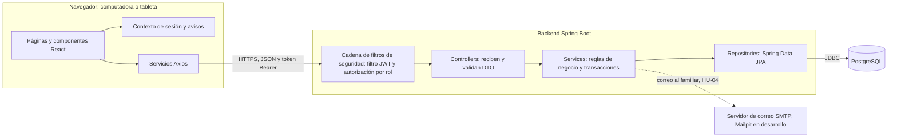

| Capa | Responsabilidad | Lo que nunca hace |
|---|---|---|
| Presentación (React) | Mostrar los datos, capturar la entrada, validar formato para avisar antes de enviar, mostrar u ocultar módulos según el rol | Decidir permisos (solo refleja lo que el backend permite) ni calcular montos |
| Controller | Recibir la petición, validar el DTO de entrada (`@Valid`), delegar al servicio y devolver el DTO de salida con el código HTTP correcto | Contener reglas de negocio o hablar con un repositorio |
| Service | Aplicar las reglas de negocio, validar las transiciones de estado, abrir transacciones y coordinar módulos | Conocer HTTP |
| Repository | Consultar y persistir entidades | Contener lógica |
| Base de datos | Garantizar la integridad: claves foráneas, restricciones únicas y transacciones ACID | Ser alcanzable desde internet |

### 2.3 Entornos

| Entorno | Dónde corre | Base de datos | Configuración |
|---|---|---|---|
| Desarrollo | Computadora personal: Vite en el puerto 5173, backend en el 8080 | PostgreSQL 15 en Docker, puerto 5433 (`docker-compose.yml`) | `application.properties` y `.env` locales, no versionados |
| Pruebas automatizadas | Computadora personal, con `./mvnw test` | PostgreSQL desechable creado por Testcontainers en cada ejecución | Propiedades de la clase de prueba |
| Producción | Servidor virtual en la nube (2.5) | PostgreSQL 15 en Docker, sin puerto publicado | `application-prod.properties` versionado sin secretos, más variables de entorno del servidor |

### 2.4 Nube o servidor propio

El enunciado pide decidir entre la nube y un servidor instalado en casa con acceso público. Se evaluaron tres opciones:

| Criterio | Servidor en casa + túnel público (Cloudflare Tunnel) | Plataforma gestionada gratuita (Vercel + Render + Neon) | **Servidor virtual en la nube (elegida)** |
|---|---|---|---|
| Costo | US$ 0 más la electricidad | US$ 0 | US$ 0 en el nivel gratuito (US$ 5–12 al mes si no hay capacidad) |
| Disponibilidad (RNF-05: 99 %) | Depende de la luz y del internet residencial; no hay acuerdo de nivel de servicio | Alta | Alta: centro de datos con energía y red redundantes |
| Tiempo de respuesta (RNF-06: 3–5 s) | Bueno | El backend gratuito se suspende sin uso, y la primera petición tarda de 30 a 50 s | Bueno: la aplicación siempre está en memoria |
| Paridad con el desarrollo | Alta | Baja: tres plataformas con configuraciones distintas | Alta: el mismo Docker Compose que en desarrollo |
| Seguridad de los datos clínicos | El historial queda en un equipo doméstico | Datos repartidos entre tres proveedores | Un solo servidor con firewall, disco cifrado por el proveedor y base sin puerto público |
| Esfuerzo de operación | Medio | Bajo | Medio: actualizaciones del sistema y respaldos a cargo propio |

**Decisión: servidor virtual en la nube.**

- **El servidor en casa se descarta por el RNF-05.** Un 99 % de disponibilidad admite como máximo 7 horas y 12 minutos de caída al mes, y un corte de luz o de internet residencial puede consumir eso en una sola tarde. Además, el asilo no puede depender de la vivienda de quien desarrolló el sistema.
- **La plataforma gestionada gratuita se descarta por el RNF-06.** El primer médico que abra el sistema por la mañana esperaría casi un minuto.
- **El servidor virtual ejecuta los mismos contenedores que el entorno de desarrollo**, lo que reduce las diferencias entre lo que se prueba y lo que se entrega.

### 2.5 Arquitectura de despliegue

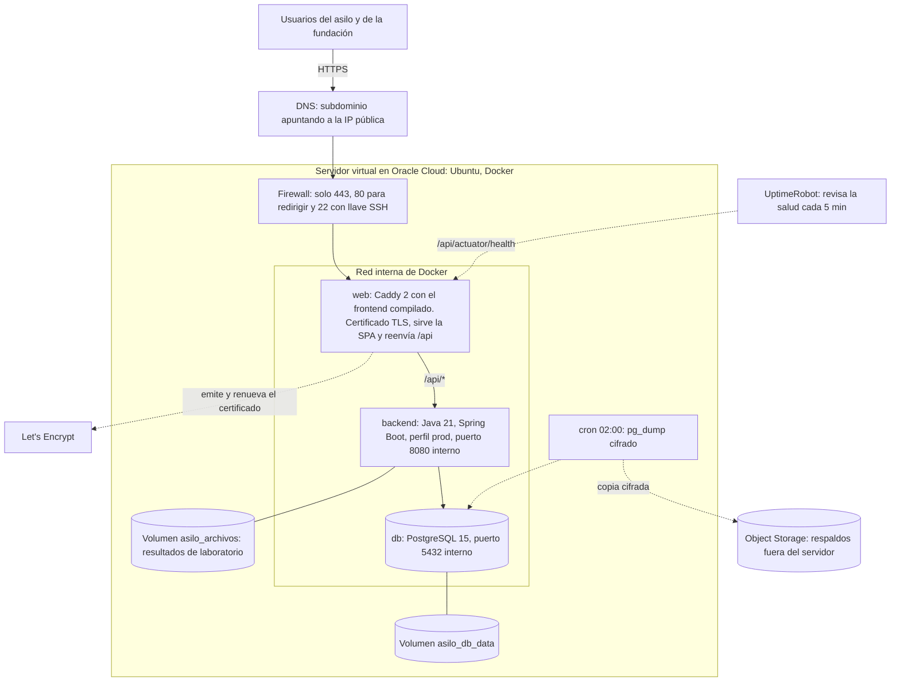

| Componente | Imagen | Expuesto a internet | Función |
|---|---|---|---|
| `web` | `caddy:2-alpine` con la compilación de Vite copiada en `/srv` | Sí: puertos 443 y 80 (el 80 solo redirige a HTTPS y atiende el reto de Let's Encrypt) | Termina TLS, sirve la aplicación React y reenvía `/api/*` al backend; agrega cabeceras de seguridad |
| `backend` | `eclipse-temurin:21-jre` con el `.jar` | No | API REST |
| `db` | `postgres:15-alpine` | No: sin mapeo de puertos, a diferencia del entorno de desarrollo | Base de datos |
| Volúmenes | `asilo_db_data`, `asilo_archivos`, `caddy_data` | No | Datos, archivos de resultados de laboratorio y certificados |

**Mismo origen para la aplicación y la API.** La aplicación se sirve en `https://<dominio>/` y la API en `https://<dominio>/api/`, así que el frontend se compila con `VITE_API_URL=/api`. Tiene tres ventajas:

- el navegador no necesita peticiones CORS previas;
- el token nunca viaja a un dominio distinto;
- hay un solo certificado que mantener.

La configuración CORS del backend se mantiene restringida al dominio como defensa adicional.

**Esquema de los archivos de despliegue (se preparan en el Sprint 2 y se usan en el despliegue del 15/10):**

```yaml
# docker-compose.prod.yml — versionado; los valores secretos vienen del .env del servidor
services:
  web:
    build: ./gestion-asilo-frontend        # etapa 1: npm run build; etapa 2: Caddy + dist
    ports: ["80:80", "443:443"]
    environment:
      DOMINIO: ${DOMINIO:?Falta DOMINIO}
    volumes: ["caddy_data:/data"]
    depends_on: [backend]
    restart: unless-stopped
  backend:
    build: ./gestion-asilo-backend         # etapa 1: ./mvnw package; etapa 2: JRE 21 + jar
    environment:
      SPRING_PROFILES_ACTIVE: prod
      TZ: America/Guatemala
      SPRING_DATASOURCE_URL: jdbc:postgresql://db:5432/${POSTGRES_DB}
      SPRING_DATASOURCE_USERNAME: ${POSTGRES_USER}
      SPRING_DATASOURCE_PASSWORD: ${POSTGRES_PASSWORD:?Falta POSTGRES_PASSWORD}
      JWT_SECRET: ${JWT_SECRET:?Falta JWT_SECRET}
      APP_CORS_ORIGENFRONTEND: https://${DOMINIO}
    volumes: ["asilo_archivos:/var/lib/asilo/archivos"]
    depends_on: [db]
    restart: unless-stopped
  db:
    image: postgres:15-alpine
    environment:
      POSTGRES_USER: ${POSTGRES_USER}
      POSTGRES_DB: ${POSTGRES_DB}
      POSTGRES_PASSWORD: ${POSTGRES_PASSWORD:?Falta POSTGRES_PASSWORD}
      TZ: America/Guatemala
    volumes: ["asilo_db_data:/var/lib/postgresql/data"]
    restart: unless-stopped
    # Sin "ports": la base de datos no es alcanzable desde fuera del servidor.
volumes:
  asilo_db_data:
  asilo_archivos:
  caddy_data:
```

```
# Caddyfile
{$DOMINIO} {
    encode gzip
    handle /api/* {
        reverse_proxy backend:8080
    }
    handle {
        root * /srv
        try_files {path} /index.html
        file_server
    }
    header {
        Strict-Transport-Security "max-age=31536000"
        X-Content-Type-Options "nosniff"
        X-Frame-Options "DENY"
        Referrer-Policy "no-referrer"
    }
}
```

**Configuración de producción.** Todo lo que no es secreto va en `application-prod.properties`, que sí se versiona: `ddl-auto`, exposición limitada de Actuator y tamaño máximo de archivos. Los secretos llegan como variables de entorno desde un `.env` del servidor que nunca entra al repositorio. Es la misma regla que ya siguen `application.properties` y el `.env` de desarrollo. Spring Boot traduce cada variable a su propiedad quitando puntos y guiones:

| Variable de entorno | Propiedad | Nota |
|---|---|---|
| `JWT_SECRET` | `jwt.secret` | Al menos 256 bits aleatorios, **distinto** del de desarrollo (ver `docs/seguridad.md`, sección 10) |
| `JWT_EXPIRATION` | `jwt.expiration` | 28800000 ms = 8 h, un turno |
| `APP_CORS_ORIGENFRONTEND` | `app.cors.origen-frontend` | El guion de `origen-frontend` desaparece en la variable |
| `APP_ADMININICIAL_CORREO` y `APP_ADMININICIAL_PASSWORD` | `app.admin-inicial.*` | Solo para el primer arranque; la contraseña se cambia al primer ingreso (HU-32) |
| `SPRING_DATASOURCE_*` | `spring.datasource.*` | Apuntan al servicio `db`, no a `localhost` |

**Procedimiento de despliegue**

1. Al cerrar el sprint, se fusiona `develop` en `main` y se crea la etiqueta (por ejemplo `v0.2.0`).
2. En el servidor, se descarga la etiqueta: `git fetch --tags && git checkout v0.2.0`.
3. Se hace un respaldo manual de la base (2.6).
4. Se reconstruye y reinicia: `docker compose -f docker-compose.prod.yml up -d --build`. La caída es de menos de un minuto; se hace de noche.
5. Prueba de humo: `GET /api/actuator/health` responde `UP`, y un inicio de sesión real funciona.
6. **Si algo falla, se revierte:** se vuelve a la etiqueta anterior y, si el esquema de la base cambió, se restaura el respaldo del paso 3.

La automatización de este procedimiento con GitHub Actions queda para después de la entrega. Con un despliegue por semana, hacerlo a mano cuesta menos que construir y depurar la automatización.

### 2.6 Disponibilidad, rendimiento y respaldos (RNF-05 y RNF-06)

**Disponibilidad (RNF-05)**

- Los contenedores se reinician solos (`restart: unless-stopped`) si el proceso cae o si el servidor se reinicia.
- UptimeRobot consulta `/api/actuator/health` cada 5 minutos y avisa por correo si no responde. Actuator se agrega con tres ajustes:
  - Solo expone el indicador de salud, sin detalles internos.
  - `application-prod.properties` mueve su ruta con `management.endpoints.web.base-path=/api/actuator`. Si no, quedaría en `/actuator`, fuera de lo que Caddy reenvía al backend.
  - `SecurityConfig` permite esa única ruta sin token, igual que el inicio de sesión.
- Los registros de los contenedores rotan por tamaño, para que un disco lleno no tumbe el sistema.

**Respaldos**

| Aspecto | Decisión |
|---|---|
| Frecuencia | Diaria a las 02:00 (`pg_dump` en formato comprimido), más uno manual antes de cada despliegue |
| Protección | Cifrado antes de salir del servidor; el historial clínico nunca queda en claro fuera de él |
| Ubicación | Object Storage, fuera del servidor: si el servidor se pierde, el respaldo sobrevive |
| Retención | 7 respaldos diarios y 4 semanales |
| Archivos | El volumen de resultados de laboratorio se respalda junto con la base |
| Verificación | Una restauración de prueba en cada sprint; un respaldo nunca restaurado no es un respaldo comprobado |
| Pérdida máxima de datos (RPO) | 24 horas |
| Tiempo máximo de recuperación (RTO) | 2 horas: crear un servidor nuevo, desplegar la etiqueta y restaurar |

**Rendimiento (RNF-06)**

- Índices en las claves foráneas y en los campos de búsqueda y filtro: nombre y DPI del interno, estado de solicitudes, órdenes y recetas.
- Los listados se paginan en el servidor, nunca se cargan completos.
- El historial médico se arma con consultas planificadas que traen visitas, órdenes y recetas en pocas consultas, evitando el problema de "N+1 consultas".
- La aplicación necesita unos 2 GB de RAM; la máquina elegida tiene holgura.

### 2.7 Seguridad en la arquitectura

El detalle de cada decisión está en [docs/seguridad.md](seguridad.md). En resumen, la arquitectura pone una defensa en cada capa:

| Capa | Defensa |
|---|---|
| Red | Solo los puertos 443 y 80 están abiertos al público; SSH solo con llave. La base de datos y el backend no tienen puerto publicado |
| Transporte | TLS con certificado de Let's Encrypt y HSTS, que obliga al navegador a no volver a usar HTTP |
| Aplicación | JWT firmado con HS256 y vigencia de 8 h; autorización por rol en cada endpoint (`@PreAuthorize`); entrada y salida solo por DTO |
| Datos | Contraseñas con BCrypt; disco cifrado por el proveedor; respaldos cifrados |
| Datos clínicos (RNF-03) | Separados del resto por diseño, no solo por permisos (secciones 3.4 y 4.9) |

---

## 3. Componentes de software

### 3.1 Vista de componentes

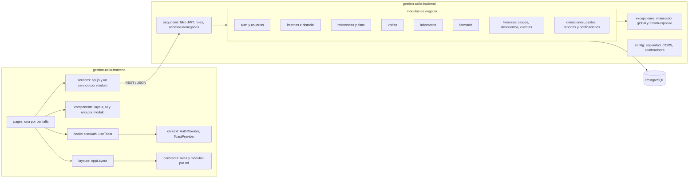

**Dependencias entre módulos del backend.** Siguen el flujo del paciente y no forman ciclos. Un módulo solo llama al servicio de un módulo anterior en el flujo, nunca a uno posterior:

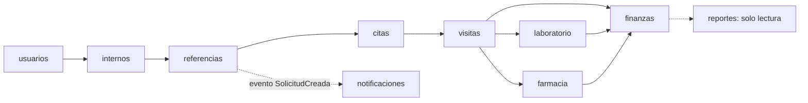

### 3.2 Plantilla de clases de un módulo

Todos los módulos del backend siguen la misma estructura, que ya se aplicó al módulo de usuarios. Diseñar un módulo nuevo consiste en llenar esta plantilla:

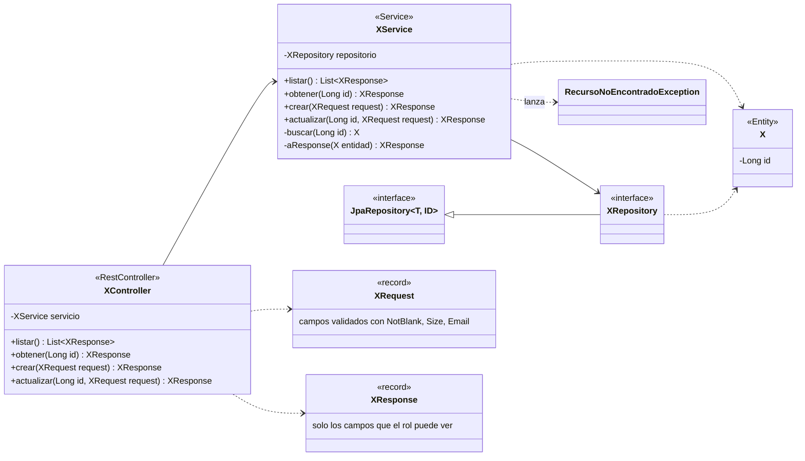

| Clase | Paquete | Responsabilidad |
|---|---|---|
| `XController` | `controllers` | Traduce HTTP a llamadas del servicio. Declara el rol requerido con `@PreAuthorize` o con una anotación compuesta como `@SoloAdministradorAsilo` |
| `XService` | `services` | Reglas de negocio y transacciones (`@Transactional`). Convierte entre entidad y DTO |
| `XRepository` | `repository` | Interfaz de Spring Data; las consultas se derivan del nombre del método |
| `X` | `models` | Entidad JPA. Nunca sale de la API |
| `XRequest` / `XResponse` | `dto` | Records inmutables: la única forma en que los datos cruzan la frontera de la API |
| Excepciones | `exception` | Excepciones de negocio que el manejador global traduce a 400, 403, 404 o 409 con un cuerpo uniforme |

### 3.3 Módulo de acceso y usuarios (implementado)

**Clases de negocio**

```mermaid
classDiagram
    direction LR
    class AuthController {
        <<RestController>>
        -AuthService authService
        +login(LoginRequest) LoginResponse
        +logout(UsuarioAutenticado) void
        +cambiarPassword(UsuarioAutenticado, CambioPasswordRequest) LoginResponse
    }
    class UsuarioController {
        <<RestController>>
        -UsuarioService usuarioService
        +listar() List~UsuarioResponse~
        +obtener(Long) UsuarioResponse
        +crear(UsuarioRequest) UsuarioResponse
        +actualizar(Long, UsuarioUpdateRequest) UsuarioResponse
        +cambiarEstado(Long, CambioEstadoRequest) UsuarioResponse
        +restablecerPassword(Long, UsuarioAutenticado, RestablecerPasswordRequest) UsuarioResponse
    }
    class AuthService {
        <<Service>>
        -AuthenticationManager authenticationManager
        -UsuarioRepository usuarioRepository
        -JwtService jwtService
        -PasswordEncoder passwordEncoder
        +login(LoginRequest) LoginResponse
        +logout(String correo) void
        +cambiarPassword(String correo, CambioPasswordRequest) LoginResponse
    }
    class UsuarioService {
        <<Service>>
        -UsuarioRepository usuarioRepository
        -RolRepository rolRepository
        -PasswordEncoder passwordEncoder
        +listar() List~UsuarioResponse~
        +obtener(Long) UsuarioResponse
        +crear(UsuarioRequest) UsuarioResponse
        +actualizar(Long, UsuarioUpdateRequest) UsuarioResponse
        +cambiarEstado(Long, boolean) UsuarioResponse
        +restablecerPassword(Long, String correoSolicitante, RestablecerPasswordRequest) UsuarioResponse
    }
    class UsuarioRepository {
        <<interface>>
        +findByCorreo(String) Optional~Usuario~
        +existsByCorreo(String) boolean
    }
    class RolRepository {
        <<interface>>
        +findByNombre(RolNombre) Optional~Rol~
    }
    class Usuario {
        <<Entity>>
        -Long id
        -String nombreCompleto
        -String correo
        -String passwordHash
        -boolean activo
        -Rol rol
        -LocalDateTime fechaInvalidacionSesiones
        -LocalDateTime fechaCreacion
        -LocalDateTime fechaActualizacion
    }
    class Rol {
        <<Entity>>
        -Long id
        -RolNombre nombre
        -String descripcion
    }
    class RolNombre {
        <<enumeration>>
        MEDICO_GENERAL
        ADMINISTRADOR_FUNDACION
        MEDICO_ESPECIALISTA
        ADMINISTRADOR_ASILO
        ENFERMERIA
        LABORATORIO
        FARMACIA
    }
    AuthController --> AuthService
    UsuarioController --> UsuarioService
    AuthService --> UsuarioRepository
    AuthService --> JwtService
    UsuarioService --> UsuarioRepository
    UsuarioService --> RolRepository
    UsuarioRepository ..> Usuario
    RolRepository ..> Rol
    Usuario "*" --> "1" Rol
    Rol --> RolNombre
```

**Clases de seguridad transversal**

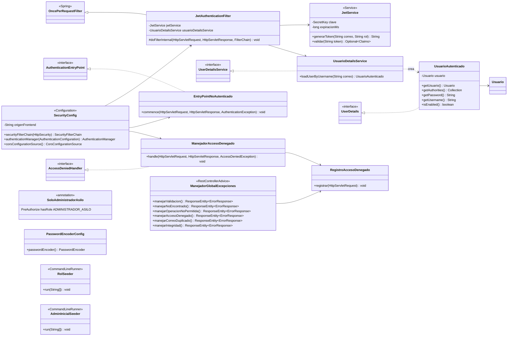

Qué hace cada pieza al recibir una petición:

1. **`JwtAuthenticationFilter`** lee la cabecera `Authorization: Bearer`, pide a `JwtService` que valide la firma y la vigencia del token, y carga el usuario con `UsuarioDetailsService`. Si el usuario está inactivo o su token es anterior a `fechaInvalidacionSesiones` (cierre de sesión o cambio de contraseña), no lo autentica.
2. **`UsuarioAutenticado`** es un **adaptador**: presenta la entidad `Usuario` como el `UserDetails` que Spring Security espera, con la autoridad `ROLE_<rol>`.
3. **`@PreAuthorize`** (o `@SoloAdministradorAsilo`) decide si el rol puede usar el endpoint.
4. **Si no hay token válido, responde `EntryPointNoAutenticado` (401). Si el rol no alcanza, responde `ManejadorAccesoDenegado` (403).** Ambos devuelven el mismo `ErrorResponse`, y `RegistroAccesoDenegado` anota el intento en el registro del servidor.

### 3.4 Modelo de dominio del flujo principal (diseño)

El diagrama de clases de la Fase de Análisis modela el dominio. Para construirlo, se refina en las entidades JPA siguientes. Las diferencias y su porqué están en la tabla que sigue a los diagramas.

**Parte clínica**

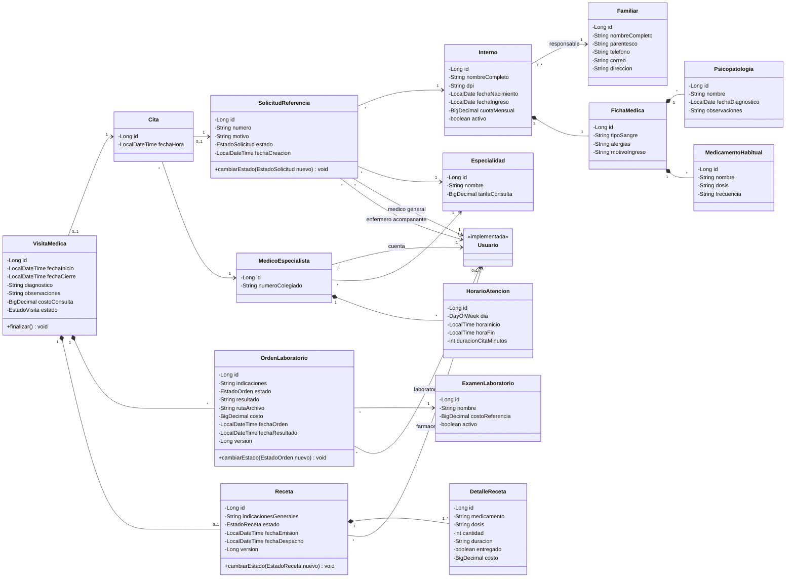

**Parte financiera**

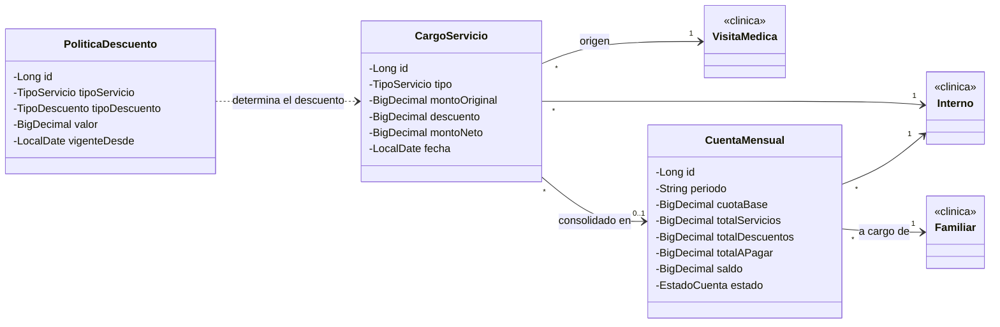

**Enumeraciones: máquinas de estado DE-01 a DE-04 y catálogos**

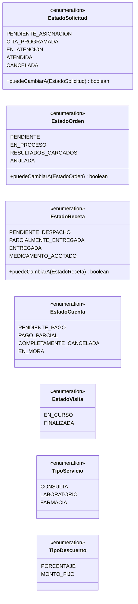

**Cambios respecto al diagrama de clases del análisis**

| En el análisis | En el diseño | Por qué |
|---|---|---|
| `Paciente` con `psicopatologia` y `medicamentosDeCajon` como texto | `Interno` (datos personales) y `FichaMedica` (datos clínicos) como entidades separadas, con listas de `Psicopatologia` y `MedicamentoHabitual` | **RNF-03.** Separar lo clínico de lo administrativo en entidades distintas hace que la vista administrativa ni siquiera cargue los datos clínicos: no hay un campo que ocultar, porque el DTO administrativo nunca toca `FichaMedica`. Además, HU-01 pide registrar varias psicopatologías y varios medicamentos, no un texto libre |
| `Medico` y `Enfermero` como clases propias con nombre y teléfono | Son `Usuario` con su rol. `MedicoEspecialista` es un perfil que agrega especialidad, número de colegiado y horario | Médicos y enfermeros ya existen como usuarios que inician sesión. Repetir sus datos en otra tabla haría que ambas copias se desincronicen |
| `estado : String` | Enumeraciones por máquina de estados (DE-01 a DE-04) con sus transiciones válidas | Un `String` admite cualquier valor, incluso uno mal escrito. El enum solo admite los estados del diagrama y rechaza las transiciones que el diagrama no contempla |
| Montos en `Float` | `BigDecimal`, columna `numeric(12,2)` | `Float` no representa exactamente valores como 0.10. Al sumar cientos de cargos se pierden centavos, algo inaceptable en cuentas por cobrar |
| `VisitaMedica` con `crearSolicitud()`, `asignarCita()` y `cerrarVisita()` | `SolicitudReferencia` → `Cita` → `VisitaMedica` | Son tres actores (médico general, fundación, especialista) en tres momentos distintos. Separarlos le da a cada actor su propia bandeja y sus propios permisos |
| `CuentaMensual.descuentoFundacion` como un solo valor | `CargoServicio` por cada servicio, con monto original, descuento y monto neto, calculados según `PoliticaDescuento` | HU-19 pide mostrar "el desglose entre costo original y descuento aplicado", y HU-14 y HU-17 piden asociar cada costo a su visita |
| `Medicamento` con `costoEspecial` y `descontarInventario()` | `DetalleReceta` con medicamento, dosis, cantidad, duración, costo y marca de entregado; sin inventario | Ningún RF pide inventario de farmacia; la farmacia pertenece a la fundación. En CU-005 el farmacéutico marca "agotado" a mano |
| `FichaMedica` "contiene" `VisitaMedica` | El historial médico no se guarda aparte: se arma consultando las visitas, órdenes y recetas del interno | Guardar el historial dos veces permitiría que las dos versiones discrepen |
| `TransaccionFinanciera` genérica | `Donacion` y `GastoOperativo` como entidades separadas | Tienen campos distintos: tipo de donante (empresa internacional, empresa nacional, gobierno, particular) frente a categoría de gasto (luz, agua…) |

### 3.5 Servicios y reglas de negocio (diseño)

```mermaid
classDiagram
    direction LR
    class InternoService {
        +registrar(InternoRequest) InternoResponse
        +actualizar(Long, InternoRequest) InternoResponse
        +listar(String busqueda, Pageable) Page~InternoResumenResponse~
        +obtener(Long) InternoResponse
        +obtenerFicha(Long) FichaMedicaResponse
    }
    class HistorialMedicoService {
        +historialDe(Long internoId) HistorialMedicoResponse
    }
    class SolicitudReferenciaService {
        +crear(SolicitudReferenciaRequest, String correoMedico) SolicitudReferenciaResponse
        +pendientes() List~SolicitudReferenciaResponse~
        +asignadasA(String correoEnfermero) List~SolicitudReferenciaResponse~
        +cancelar(Long) SolicitudReferenciaResponse
    }
    class CitaService {
        +disponibilidad(Long medicoId, LocalDate fecha) List~FranjaHorariaResponse~
        +asignar(Long solicitudId, AsignacionCitaRequest) CitaResponse
        +agendaDe(String correoMedico, LocalDate fecha) List~CitaResponse~
    }
    class VisitaMedicaService {
        +iniciar(Long citaId, String correoMedico) VisitaMedicaResponse
        +historialDuranteVisita(Long visitaId, String correoMedico) HistorialMedicoResponse
        +registrarDiagnostico(Long, DiagnosticoRequest) VisitaMedicaResponse
        +recetar(Long, RecetaRequest) RecetaResponse
        +ordenarExamenes(Long, OrdenesLaboratorioRequest) List~OrdenLaboratorioResponse~
        +finalizar(Long) VisitaMedicaResponse
    }
    class LaboratorioService {
        +ordenes(EstadoOrden, String paciente, Pageable) Page~OrdenLaboratorioResponse~
        +iniciar(Long ordenId) OrdenLaboratorioResponse
        +registrarResultado(Long, ResultadoLaboratorioRequest, MultipartFile) OrdenLaboratorioResponse
    }
    class FarmaciaService {
        +recetas(EstadoReceta, String paciente, Pageable) Page~RecetaResponse~
        +despachar(Long recetaId, DespachoRequest) RecetaResponse
    }
    class CargoService {
        +registrar(VisitaMedica, TipoServicio, BigDecimal montoOriginal) CargoServicio
    }
    class CalculadoraDescuento {
        +calcular(TipoServicio, BigDecimal montoOriginal) DesgloseCosto
    }
    class ReglaDescuento {
        <<interface>>
        +aplicar(BigDecimal monto, BigDecimal valor) BigDecimal
    }
    class DescuentoPorcentaje
    class DescuentoMontoFijo
    class CuentaFamiliarService {
        +consolidar(Long internoId, YearMonth periodo) EstadoCuentaResponse
        +cargosPorRango(Long internoId, LocalDate desde, LocalDate hasta) EstadoCuentaResponse
    }
    class SolicitudCreadaEvent {
        <<evento>>
        +Long solicitudId
    }
    class NotificacionService {
        <<asíncrono>>
        +alCrearSolicitud(SolicitudCreadaEvent) void
    }
    SolicitudReferenciaService --> InternoService
    CitaService --> SolicitudReferenciaService
    VisitaMedicaService --> CitaService
    VisitaMedicaService --> HistorialMedicoService
    VisitaMedicaService --> CargoService
    LaboratorioService --> CargoService
    FarmaciaService --> CargoService
    CargoService --> CalculadoraDescuento
    CalculadoraDescuento --> ReglaDescuento
    ReglaDescuento <|.. DescuentoPorcentaje
    ReglaDescuento <|.. DescuentoMontoFijo
    SolicitudReferenciaService ..> SolicitudCreadaEvent : publica
    NotificacionService ..> SolicitudCreadaEvent : escucha
```

**Reglas de negocio que viven en los servicios**, tomadas de los criterios de aceptación en Jira:

| Regla | Servicio | Origen |
|---|---|---|
| La solicitud nace con número correlativo (`REF-2026-0001`) y estado `PENDIENTE_ASIGNACION`; son obligatorios el interno, la especialidad, el enfermero y el motivo | `SolicitudReferenciaService` | HU-03, CU-001 |
| Solo se asigna cita a una solicitud `PENDIENTE_ASIGNACION`, en una franja libre del especialista; la solicitud pasa a `CITA_PROGRAMADA` | `CitaService` | HU-06, CU-002 |
| Una visita solo se inicia desde una cita `CITA_PROGRAMADA` y por el especialista asignado. La solicitud pasa a `EN_ATENCION` y la visita toma la tarifa de consulta de la especialidad | `VisitaMedicaService` | HU-07, CU-003 |
| El especialista ve el historial **solo mientras tiene una visita activa de ese interno** | `VisitaMedicaService` | HU-08 |
| No se finaliza una visita sin diagnóstico; al finalizarla, la solicitud pasa a `ATENDIDA` y se registra el cargo de la consulta | `VisitaMedicaService` | HU-09, CU-003 E.1 |
| Cada examen ordenado crea una `OrdenLaboratorio` en `PENDIENTE` | `VisitaMedicaService` | HU-11 |
| Un resultado solo se registra sobre una orden `PENDIENTE` o `EN_PROCESO`; el costo debe ser mayor a cero y genera su cargo | `LaboratorioService` | HU-13, HU-14 |
| Una receta `ENTREGADA` no se vuelve a despachar. Dos farmacéuticos simultáneos no pueden despacharla dos veces: la columna `version` activa el bloqueo optimista de JPA y el segundo recibe 409 | `FarmaciaService` | HU-16 |
| Solo se cobran los medicamentos marcados como entregados | `FarmaciaService` | HU-17, CU-005 E.2 |
| Monto neto = monto original − descuento, **nunca menor que cero** | `CalculadoraDescuento` | HU-19 |
| La cuenta mensual suma la cuota base del interno más los cargos netos del mes | `CuentaFamiliarService` | HU-18, CU-006 |

**Transiciones de estado.** Cada enumeración declara qué transiciones son válidas. La entidad expone un solo método para cambiar su estado, `cambiarEstado(nuevo)`, que lanza `OperacionNoPermitidaException` (409) si el diagrama no contempla la transición. Así ningún servicio puede, por ejemplo, devolver una solicitud `ATENDIDA` a `PENDIENTE_ASIGNACION`, aunque lo intente. Las transiciones de la solicitud de referencia (DE-01) son:

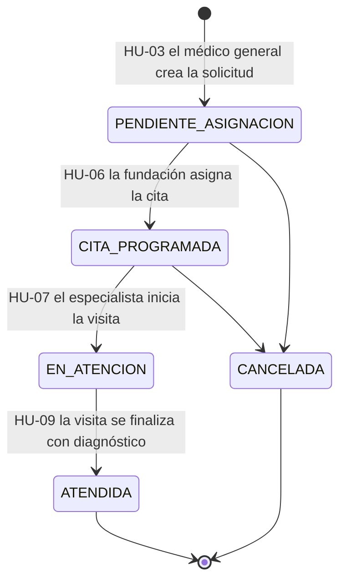

### 3.6 Resumen de componentes

| Módulo | Clases principales | Historias | Estado |
|---|---|---|---|
| Autenticación | `AuthController`, `AuthService`, `JwtService`, `JwtAuthenticationFilter`, `UsuarioDetailsService`, `UsuarioAutenticado` | HU-30, HU-32 | Implementado |
| Usuarios y roles | `UsuarioController`, `UsuarioService`, `Usuario`, `Rol`, `RolNombre`, `RolSeeder`, `AdminInicialSeeder` | HU-29, HU-31 | Implementado |
| Seguridad transversal | `SecurityConfig`, `ManejadorAccesoDenegado`, `EntryPointNoAutenticado`, `RegistroAccesoDenegado`, `SoloAdministradorAsilo` | HU-31 | Implementado |
| Excepciones | `ManejadorGlobalExcepciones`, `ErrorResponse` y excepciones de negocio | Transversal | Implementado |
| Internos e historial | `Interno`, `FichaMedica`, `Familiar`, `InternoService`, `HistorialMedicoService` | HU-01, HU-02 | Sprint 2. Backend de HU-01 implementado (`InternoController`, `InternoService`) |
| Referencias y citas | `SolicitudReferencia`, `Cita`, `Especialidad`, `MedicoEspecialista`, `HorarioAtencion` y sus servicios | HU-03, HU-05, HU-06 | Sprint 2 |
| Visitas | `VisitaMedica`, `Receta`, `DetalleReceta`, `VisitaMedicaService` | HU-07 a HU-11 | Sprint 2 (HU-07 a HU-10); Sprint 3 (HU-11) |
| Laboratorio | `OrdenLaboratorio`, `ExamenLaboratorio`, `LaboratorioService` | HU-12 a HU-14 | Sprint 3 |
| Farmacia | `FarmaciaService` (sobre `Receta`) | HU-15 a HU-17 | Sprint 3 |
| Finanzas | `CargoServicio`, `PoliticaDescuento`, `CuentaMensual`, `CargoService`, `CalculadoraDescuento`, `CuentaFamiliarService` | HU-18, HU-19 | Sprint 3 |
| Notificaciones | `SolicitudCreadaEvent`, `NotificacionService` (Spring Mail, asíncrono) | HU-04 | Sprint 2 |
| Donaciones, gastos, cuentas por pagar | `Donacion`, `GastoOperativo`, `PagoFundacion`, `Pago` | HU-20 a HU-23 | Sprint 3 |
| Reportes | `ReporteService` y plantillas PDF | HU-24 a HU-28 | Sprint 3 |

---

## 4. Experiencia de usuario

### 4.1 Usuarios y contexto de uso

| Rol | Dónde trabaja | Dispositivo principal | Tarea principal | Qué **no** debe ver |
|---|---|---|---|---|
| Médico General | Asilo: consultorio y dormitorios | Tableta y computadora | Registrar internos, consultar su historial, referirlos | — |
| Administrador de la Fundación | Oficina de la fundación | Computadora | Recibir referencias y asignar citas | Ficha médica e historial; solo ve el motivo de la referencia |
| Médico Especialista | Consultorio de la fundación | Computadora | Atender la visita: diagnóstico, receta, exámenes | El historial de internos que no atiende en ese momento |
| Administrador del Asilo | Oficina del asilo | Computadora de escritorio | Usuarios, cuentas por cobrar y finanzas | **Diagnósticos, psicopatologías y medicamentos (RNF-03)** |
| Enfermería | Dormitorios; acompaña al interno a la fundación | Tableta, de pie y en movimiento | Consultar sus acompañamientos y citas; conocer los medicamentos del interno | Finanzas |
| Laboratorio | Laboratorio de la fundación | Laptop | Registrar resultados y su costo | Diagnóstico e historial; solo la orden |
| Farmacia | Farmacia de la fundación | Laptop | Despachar recetas y registrar su costo | Diagnóstico e historial; solo la receta |

El RNF-04 describe a buena parte del personal como "no experto en tecnología". Ese dato, junto con el uso en tableta durante las rondas, es el que más condiciona el diseño.

### 4.2 Principios de diseño

1. **Cada rol ve solo su trabajo** (RNF-02, RNF-03). El menú, las pantallas y los datos de cada respuesta dependen del rol. Un módulo que no le corresponde no aparece en el menú, y si alguien escribe su dirección a mano ve una pantalla que le explica que no tiene acceso.
2. **Legible para personal no técnico** (RNF-04).
   - Tipografía Inter; ningún texto menor de 14 px.
   - Contraste AA verificado para todos los colores.
   - Lenguaje del dominio y no de la informática: "Referir a especialista", no "Crear registro".
3. **Operable de pie con una tableta.**
   - Toda área táctil mide al menos 44 × 44 px.
   - El ancho de tableta (768 px) es un caso de primera clase, no una adaptación.
   - En tableta el menú se abre como cajón para dejar el ancho al contenido.
4. **El estado nunca se comunica solo con color.** Siempre van juntos color, ícono y texto: alrededor del 8 % de los hombres no distingue rojo de verde.
5. **Prevenir antes que corregir.**
   - Los formularios validan en línea con las mismas reglas que el backend.
   - Las acciones con consecuencias piden confirmación.
6. **Saber siempre de quién es el expediente.** Toda pantalla clínica muestra un encabezado fijo con el nombre y los datos de identificación del interno. Registrar en el expediente equivocado es uno de los errores clínicos más graves y más fáciles de cometer.
7. **Respuesta inmediata.**
   - Mientras carga, la tabla muestra su forma (esqueleto) en lugar de saltar.
   - Cada acción termina en un aviso visible.
   - Los errores del backend se muestran junto al campo que los causó.

### 4.3 Arquitectura de información y navegación

Todos los roles entran a un **Dashboard** común y navegan con un menú lateral que solo contiene sus módulos. El menú se genera a partir de una única matriz ([constants/modulos.js](../gestion-asilo-frontend/src/constants/modulos.js)):

| Rol | Módulos del menú |
|---|---|
| Médico General | Dashboard · Internos · Historial médico · Solicitudes de referencia |
| Administrador de la Fundación | Dashboard · Solicitudes entrantes · Agenda y asignación · Médicos y disponibilidad |
| Médico Especialista | Dashboard · Mi agenda del día · Visitas médicas · Órdenes de laboratorio · Recetas |
| Administrador del Asilo | Dashboard · Usuarios y roles · Internos (vista administrativa) · Cuentas por cobrar · Cuentas por pagar · Donaciones · Gastos · Reportes · Configuración |
| Enfermería | Dashboard · Internos · Solicitudes asignadas · Citas |
| Laboratorio | Dashboard · Órdenes pendientes · Registro de resultados |
| Farmacia | Dashboard · Recetas pendientes · Despacho de medicamentos |

Decidido el 14/10, con HU-02: el Médico Especialista ya no tiene "Historial médico" en su menú. Por HU-08 ve los antecedentes del paciente solo durante su visita activa, y ahí ya los tiene; un módulo aparte no tendría nada que mostrarle sin contradecir ese criterio. El del Médico General abre la lista de internos, y cada fila lleva al historial de ese interno.

Cada módulo del menú puede estar en tres situaciones, y cada una dice algo distinto:

- **Construido:** se usa normalmente.
- **Aún no construido:** aparece en gris, deshabilitado. Le muestra al usuario el alcance del sistema y le indica que llegará después.
- **De otro rol:** no aparece. Le indica que no es parte de su trabajo.

El guardia de rutas y el menú consultan la misma matriz, así que no pueden discrepar. Aun así, **la autoridad es el backend**: si el guardia fallara, la API respondería 403 de todos modos.

La vista de internos del Administrador del Asilo se llama "Internos (vista administrativa)" a propósito. Es una pantalla distinta, alimentada por endpoints distintos, y no la misma pantalla con campos ocultos (RNF-03).

### 4.4 Patrones de experiencia de usuario

| Patrón | Qué resuelve | Dónde se usa | Componente |
|---|---|---|---|
| Navegación lateral persistente y cajón en tableta | Orientación constante sin quitar espacio al contenido en pantallas angostas | Toda la aplicación | `Sidebar`, `CajonNavegacion`, `MenuPrincipal` |
| Migas de pan | Saber en qué pantalla se está y volver a la anterior | Barra superior | `Navbar` (propiedad `migas`) |
| **Bandeja de trabajo por estado** | Cada rol recibe trabajo de otro; la bandeja le muestra lo que le toca, ordenado y filtrable por estado, con la acción principal en cada fila | Solicitudes entrantes (fundación), Mi agenda (especialista), Órdenes pendientes (laboratorio), Recetas pendientes (farmacia), Solicitudes asignadas (enfermería) | `DataTable`, `StatusBadge`, `EmptyState` |
| Maestro-detalle con pestañas | Ir de la lista de internos al perfil sin perder el contexto | Internos → perfil con pestañas *Datos*, *Ficha médica* e *Historial* (roles clínicos); *Datos*, *Familiar* y *Estado de cuenta* (vista administrativa) | `DataTable`, `Tabs` |
| Encabezado de paciente fijo | Evitar registrar en el expediente equivocado | Perfil, visita médica, orden de laboratorio, receta | `PatientHeader` |
| Formulario en modal o en página completa según su tamaño | Un formulario corto no justifica cambiar de pantalla; uno largo en un modal se vuelve incómodo en tableta | Modal: usuario, solicitud de referencia, asignación de cita, resultado. Página: registro del interno, visita médica | `Modal`, `FormField` |
| Validación en línea y errores del servidor por campo | Corregir antes de enviar; si el backend rechaza, el error aparece junto al campo, no en un mensaje genérico | Todos los formularios | `FormField`, `erroresPorCampo()` |
| Confirmación de acciones con consecuencias | Evitar lo que no se puede deshacer con un toque accidental | Desactivar usuario, cancelar solicitud, finalizar visita, despachar receta | `ConfirmDialog` |
| Protección contra descarte de cambios | No perder un formulario a medias al cerrar el modal | Formulario de usuario; se replica en los demás | `UsuarioFormModal` |
| Línea de tiempo | Leer el historial clínico en orden cronológico, lo más reciente arriba | Historial médico | `Timeline`, `MedicalRecordCard` |
| Búsqueda con autocompletado | Encontrar al paciente por nombre o DPI al llegar al laboratorio o a la farmacia | Laboratorio, farmacia (CU-004 paso 1) | `SearchAutocomplete` |
| Selector de franjas horarias | Asignar una cita solo en horarios libres del especialista | Asignación de cita (HU-06) | `AvailabilityCalendar` |
| Respuesta no bloqueante | Confirmar el éxito sin interrumpir; mostrar la carga sin saltos; explicar las listas vacías | Toda la aplicación | `Toast`, `Alert`, `TablaSkeleton`, `EmptyState` |
| Recuperación de la sesión | Si el token vence, avisar y, al volver a entrar, regresar a la pantalla donde estaba | Toda la aplicación | `AuthProvider`, `LoginPage` |
| Entrada monetaria | Montos en quetzales, con cifras alineadas y sin confundir 0 con O | Costos de laboratorio y farmacia, cuentas | `CurrencyInput` (`tabular-nums slashed-zero`) |

### 4.5 Recorrido principal entre pantallas

El flujo clínico de DS-01 y DS-02, visto como recorrido por las pantallas de cada rol. Entre corchetes, el estado que queda visible en las bandejas de los demás:

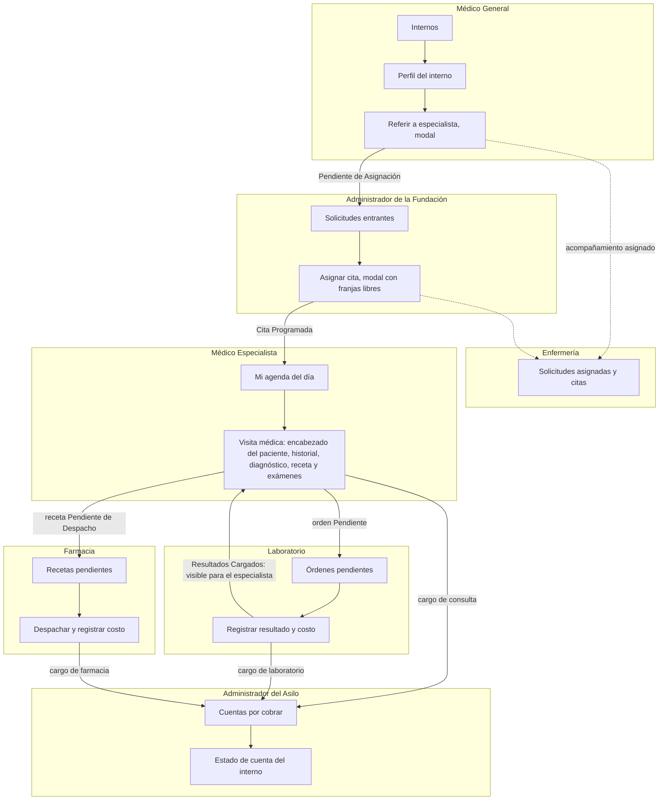

### 4.6 Estados visibles

El componente `StatusBadge` es la única fuente de verdad para pintar un estado: "Pendiente" se ve igual en medicina, laboratorio, farmacia y finanzas. Hoy solo distingue activo o inactivo (usuarios). **En el Sprint 2 se generaliza a `StatusBadge({ estado })`** con el mapa completo de los diagramas de estados:

| Máquina de estados | Advertencia (ámbar, reloj) | En proceso (violeta, actividad) | Información (azul, calendario) | Éxito (verde, check) | Error (rojo, alerta) | Neutral (gris) |
|---|---|---|---|---|---|---|
| DE-01 Solicitud | Pendiente de Asignación | En Atención | Cita Programada | Atendida | — | Cancelada |
| DE-02 Orden de laboratorio | Pendiente | En Proceso | — | Resultados Cargados | — | Anulada |
| DE-03 Receta | Pendiente de Despacho | Parcialmente Entregada | — | Entregada | Medicamento Agotado | — |
| DE-04 Cuenta mensual | Pendiente de Pago | Pago Parcial | — | Completamente Cancelada | En Mora | — |

### 4.7 Patrones de diseño de software

**Frontend**

| Patrón | Dónde | Por qué |
|---|---|---|
| Proveedor de contexto | `AuthProvider`, `ToastProvider` | La sesión y los avisos los necesita cualquier pantalla; el contexto evita pasarlos de componente en componente |
| Hook como fachada | `useAuth()`, `useToast()` | Ocultan el contexto detrás de una función, y fallan con un mensaje claro si se usan fuera de su proveedor |
| Capa de servicios (*gateway*) | [services/api.js](../gestion-asilo-frontend/src/services/api.js) y un `*Service.js` por módulo | Ningún componente llama a Axios directamente. Si cambia una ruta de la API, se cambia en un solo lugar |
| Interceptor | Interceptores de Axios en `api.js` | Adjuntan el token a cada petición y detectan el 401 en un solo lugar, en lugar de repetirlo en cada llamada |
| Observador | Evento `asilo:sesion-expirada` del navegador, que escucha `AuthProvider` | El interceptor no conoce React; avisa con un evento y el proveedor decide cómo cerrar la sesión |
| Guardia de ruta | `RutaPrivada` en [App.jsx](../gestion-asilo-frontend/src/App.jsx) | Primero exige sesión y después permiso del rol, en ese orden: a quien no tiene sesión se le pide iniciarla, no se le dice "sin permiso" |
| Configuración como fuente única | `constants/modulos.js` | El menú y el guardia salen de la misma matriz, así que no pueden contradecirse |
| Composición | `AppLayout({ migas, children })` | Todas las pantallas comparten el esqueleto y solo aportan su contenido |
| Componentes presentacionales y páginas contenedoras | `components/ui` y `pages` | Los de `ui` no conocen la API y se reutilizan en cualquier módulo; las páginas cargan los datos y coordinan |
| Reinicio por clave | `RestablecerPasswordModal` (propiedad `clave`) | Un formulario nuevo en cada apertura, sin restos de la anterior ni código de limpieza |

**Backend**

| Patrón | Dónde | Por qué |
|---|---|---|
| Arquitectura en capas | Controller → Service → Repository | Separación de responsabilidades (sección 2.2) |
| DTO | Paquete `dto`, con *records* inmutables | La entidad nunca sale de la API. Por ejemplo, devolver `Usuario` filtraría `passwordHash` en cada respuesta |
| Repositorio | Interfaces de Spring Data JPA | Consultas sin SQL escrito a mano, verificadas al arrancar la aplicación |
| Inyección de dependencias por constructor | Todos los componentes | Dependencias explícitas e inmutables; se prueban sin trucos |
| Cadena de responsabilidad | `SecurityFilterChain` con `JwtAuthenticationFilter` | Cada filtro resuelve un aspecto (CORS, token, autorización) y pasa la petición al siguiente |
| Adaptador | `UsuarioAutenticado` | Presenta la entidad `Usuario` como el `UserDetails` que Spring Security espera, sin acoplar la entidad al framework |
| Estrategia | `PasswordEncoder` delegado (hash con prefijo `{bcrypt}`); `ReglaDescuento` (diseño) | Cambiar de algoritmo (Argon2) o de tipo de descuento (porcentaje o monto fijo) sin tocar a quien lo usa |
| Manejo centralizado de excepciones | `ManejadorGlobalExcepciones` (`@RestControllerAdvice`) | Un solo formato de error para toda la API; los servicios lanzan excepciones de negocio sin conocer HTTP |
| Anotación compuesta | `@SoloAdministradorAsilo` | La regla de autorización se escribe una vez y se nombra, en lugar de repetir una expresión en cada método |
| Sembrador al arranque | `RolSeeder`, `AdminInicialSeeder` | Los catálogos fijos (roles; en el diseño, especialidades y exámenes) existen desde el primer arranque sin intervención manual |
| Máquina de estados en enumeración (diseño) | `EstadoSolicitud`, `EstadoOrden`, `EstadoReceta` | Las transiciones de DE-01 a DE-04 se validan en un solo lugar |
| Eventos de dominio / observador (diseño) | `SolicitudCreadaEvent` → `NotificacionService` | HU-04 (correo al familiar) se agrega **sin modificar** `SolicitudReferenciaService` (principio abierto/cerrado). Como es asíncrono, si el correo falla la solicitud igual se guarda (CU-001, excepción E.1) |
| Bloqueo optimista (diseño) | `@Version` en `Receta` y `OrdenLaboratorio` | Impide el doble despacho o el doble registro de resultados por dos usuarios simultáneos (HU-16) |

### 4.8 Clases de interfaz del frontend

En React, cada componente es una función que recibe propiedades (*props*). En los diagramas siguientes, cada componente se representa como una clase y sus atributos son esas props.

**Implementadas (Sprint 1)**

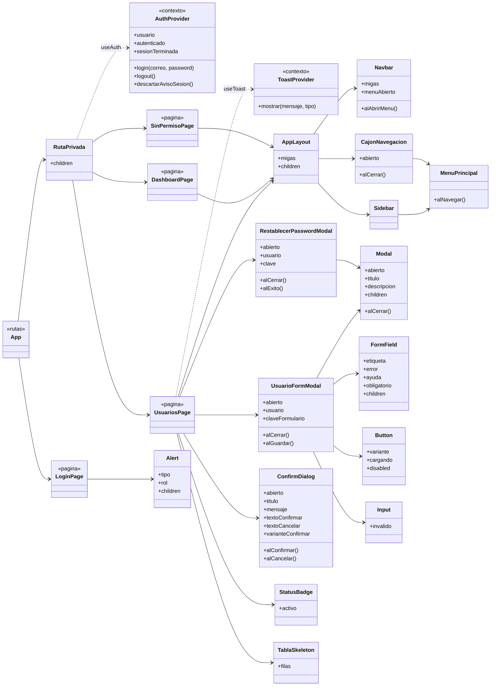

**Diseñadas para el flujo principal**

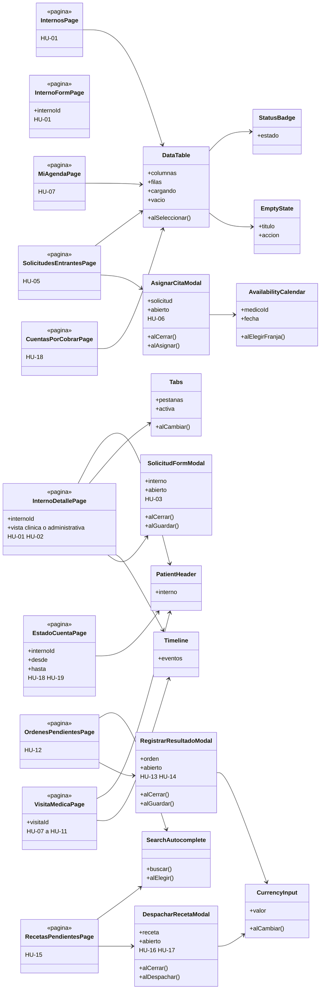

**Servicios del frontend**

Son la frontera del frontend con la API. Cada función corresponde a un endpoint de la sección 4.9.

| Servicio | Funciones | Estado |
|---|---|---|
| `authService.js` | `iniciarSesion(correo, password)`, `cerrarSesion()` | Implementado |
| `usuarioService.js` | `listarUsuarios()`, `crearUsuario(u)`, `actualizarUsuario(id, u)`, `cambiarEstadoUsuario(id, activo)`, `restablecerPasswordUsuario(id, password)` | Implementado |
| `internoService.js` | `listarInternos(busqueda, pagina)`, `obtenerInterno(id)`, `obtenerFichaMedica(id)`, `registrarInterno(i)`, `actualizarInterno(id, i)`, `obtenerHistorial(id)` | Sprint 2. El backend de las cinco primeras ya existe |
| `referenciaService.js` | `crearSolicitud(s)`, `listarPendientes()`, `listarAsignadas()`, `consultarDisponibilidad(medicoId, fecha)`, `asignarCita(solicitudId, c)` | Sprint 2 |
| `visitaService.js` | `miAgenda(fecha)`, `iniciarVisita(citaId)`, `historialDeVisita(id)`, `registrarDiagnostico(id, d)`, `recetar(id, r)`, `ordenarExamenes(id, o)`, `finalizarVisita(id)` | Sprint 2; `ordenarExamenes` en el Sprint 3 |
| `laboratorioService.js` | `listarOrdenes(estado, paciente)`, `iniciarOrden(id)`, `registrarResultado(id, datos, archivo)` | Sprint 3 |
| `farmaciaService.js` | `listarRecetas(estado, paciente)`, `despacharReceta(id, detalle)` | Sprint 3 |
| `cuentaService.js` | `listarCuentas(periodo)`, `estadoDeCuenta(internoId, desde, hasta)`, `consolidar(periodo)` | Sprint 3 |

### 4.9 Clases de interfaz del backend

La interfaz del backend es su **API REST**: los controladores y los DTO que reciben y devuelven. Estas son sus convenciones:

- Todas las rutas empiezan por `/api`, usan sustantivos en plural y en español, e intercambian JSON.
- Todas exigen la cabecera `Authorization: Bearer <token>`, salvo el inicio de sesión.

**Formato de error común** (`ErrorResponse`), idéntico en cualquier endpoint y ante cualquier fallo:

```json
{
  "timestamp": "2026-10-05T10:15:30",
  "estado": 400,
  "error": "Bad Request",
  "mensaje": "La solicitud tiene datos inválidos",
  "ruta": "/api/solicitudes-referencia",
  "errores": { "motivo": "El motivo de referencia es obligatorio" }
}
```

| Código | Cuándo |
|---|---|
| 200 / 201 / 204 | Éxito / recurso creado / éxito sin cuerpo |
| 400 | DTO inválido; `errores` trae el mensaje de cada campo |
| 401 | Sin token, token vencido o sesión invalidada |
| 403 | El rol no puede usar el endpoint (queda anotado en el registro del servidor) |
| 404 | El recurso no existe |
| 409 | Conflicto: correo duplicado, transición de estado inválida, doble despacho |

**Roles:** MG = Médico General · AF = Administrador de la Fundación · ME = Médico Especialista · AA = Administrador del Asilo · ENF = Enfermería · LAB = Laboratorio · FAR = Farmacia · *todos* = cualquier usuario autenticado.

**Endpoints implementados**

| Método | Ruta | Roles | Entrada | Salida | HU |
|---|---|---|---|---|---|
| POST | `/api/auth/login` | público | `LoginRequest` | `LoginResponse` | HU-30 |
| POST | `/api/auth/logout` | todos | — | 204 | HU-30 |
| PUT | `/api/auth/password` | todos | `CambioPasswordRequest` | `LoginResponse` (token nuevo) | HU-30 |
| GET | `/api/usuarios` | AA | — | `List<UsuarioResponse>` | HU-29 |
| GET | `/api/usuarios/{id}` | AA | — | `UsuarioResponse` | HU-29 |
| POST | `/api/usuarios` | AA | `UsuarioRequest` | `UsuarioResponse` (201) | HU-29 |
| PUT | `/api/usuarios/{id}` | AA | `UsuarioUpdateRequest` | `UsuarioResponse` | HU-29 |
| PATCH | `/api/usuarios/{id}/estado` | AA | `CambioEstadoRequest` | `UsuarioResponse` | HU-29 |
| PUT | `/api/usuarios/{id}/password` | AA (sobre otra persona) | `RestablecerPasswordRequest` | `UsuarioResponse` | HU-30 |

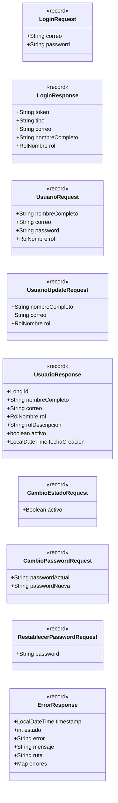

**Endpoints diseñados para el flujo principal**

| Método | Ruta | Roles | Entrada | Salida | HU |
|---|---|---|---|---|---|
| GET | `/api/internos?busqueda=&pagina=` | MG, ME, ENF, AA | — | `Page<InternoResumenResponse>` | HU-01 |
| POST | `/api/internos` | MG | `InternoRequest` (datos personales y familiar; la ficha se escribe después, por su propio endpoint) | `InternoResponse` (201) | HU-01 |
| GET | `/api/internos/{id}` | MG, ME, ENF, AA | — | `InternoResponse` (sin datos clínicos) | HU-01 |
| PUT | `/api/internos/{id}` | MG | `InternoRequest` | `InternoResponse` | HU-01 |
| GET | `/api/internos/{id}/ficha-medica` | MG, ME, ENF | — | `FichaMedicaResponse` | HU-01 |
| PUT | `/api/internos/{id}/ficha-medica` | MG | `FichaMedicaRequest` | `FichaMedicaResponse` | HU-01 |
| GET | `/api/internos/{id}/historial` | MG | — | `HistorialMedicoResponse`: todas las visitas del interno con su diagnóstico, incluida la que esté en curso, de la más reciente a la más antigua, y las recetas y los exámenes, cada uno con el `visitaId` de la consulta de la que salió; 404 si el interno no existe | HU-02 |
| GET | `/api/especialidades` | MG, AF | — | `List<EspecialidadResponse>` | HU-03 |
| GET | `/api/especialidades/tarifas` | AF | — | `List<EspecialidadTarifaResponse>` (con la tarifa de consulta, vacía si no tiene) | HU-07 |
| PUT | `/api/especialidades/{id}/tarifa` | AF | `TarifaRequest` | `EspecialidadTarifaResponse` | HU-07 |
| GET | `/api/enfermeros` | MG | — | `List<ResumenPersona>` (id y nombre, sin correo) | HU-03 |
| GET | `/api/solicitudes-referencia/{id}/notificaciones` | MG, AF | — | `List<NotificacionResponse>` (sin el correo ni el error) | HU-04 |
| POST | `/api/solicitudes-referencia/{id}/notificaciones/reintentar` | MG, AF | — | `List<NotificacionResponse>` | HU-04 |
| POST | `/api/solicitudes-referencia` | MG | `SolicitudReferenciaRequest` | `SolicitudReferenciaResponse` (201) | HU-03 |
| GET | `/api/solicitudes-referencia?estado=&busqueda=&page=&sort=` | AF, MG | — | `Page<SolicitudReferenciaResponse>`; sin `estado`, todas; `busqueda` por número, interno o especialidad, sin importar tildes (YS-166); `sort` solo por `fechaCreacion` o `numero`, cualquier otro campo es 400. Sin `sort`, de la más antigua a la más reciente; la pantalla pide las más recientes primero | HU-05 |
| GET | `/api/solicitudes-referencia/asignadas` | ENF | — | `List<SolicitudReferenciaResponse>` | HU-03 |
| PATCH | `/api/solicitudes-referencia/{id}/cancelar` | MG, AF | — | `SolicitudReferenciaResponse` | DE-01 |
| GET | `/api/especialistas?especialidadId=` | AF | — | `List<EspecialistaResponse>`; sin especialidad, todos; con ella, solo los activos que la atienden | HU-06 |
| GET | `/api/especialistas/usuarios-disponibles` | AF | — | `List<ResumenPersona>`: cuentas activas de Médico Especialista sin perfil | HU-06 |
| POST | `/api/especialistas` | AF | `EspecialistaRequest` (cuenta, especialidad, duración de la cita, horario por día) | `EspecialistaResponse` (201); 409 si la cuenta ya tiene perfil | HU-06 |
| PUT | `/api/especialistas/{id}` | AF | `EspecialistaRequest` (más `activo`) | `EspecialistaResponse` | HU-06 |
| GET | `/api/especialistas/{id}/disponibilidad?fecha=` | AF | — | `List<LocalTime>`: las horas libres de ese día, ya sin las pasadas ni las ocupadas | HU-06 |
| POST | `/api/solicitudes-referencia/{id}/cita` | AF | `AsignacionCitaRequest` (especialista, fecha y hora) | `CitaResponse` (201); 400 si la hora no es una franja del horario o ya pasó; 409 si está ocupada o la solicitud ya no está pendiente | HU-06 |
| GET | `/api/solicitudes-referencia/{id}/cita` | MG, AF | — | `CitaResponse`; 404 si todavía no tiene | HU-06 |
| GET | `/api/citas/mi-agenda?fecha=` | ME | — | `List<CitaAgendaResponse>` (paciente, hora, motivo, acompañante y la visita si ya se inició); sin fecha, hoy; 404 si la cuenta no tiene perfil de especialista | HU-07 |
| GET | `/api/citas?desde=&hasta=` | ENF, MG | — | `List<CitaResponse>` | HU-06 |
| POST | `/api/citas/{id}/visita` | ME (el asignado) | — | `VisitaMedicaResponse` (201); 403 si la cita es de otro especialista; 409 si ya se inició, si la solicitud no está en `CITA_PROGRAMADA` o si todavía no es el día de la cita | HU-07 |
| GET | `/api/visitas?estado=` | ME | — | `List<VisitaMedicaResponse>`: las del especialista, la más reciente primero | HU-07 |
| GET | `/api/visitas/{id}` | ME (el de la visita) | — | `VisitaMedicaResponse` | HU-07 |
| GET | `/api/visitas/{id}/historial` | ME (visita activa propia) | — | `HistorialMedicoResponse`: las visitas anteriores del interno con su diagnóstico, sin la visita en curso; 403 con la visita finalizada o de otro especialista. HU-10 le agregó las recetas y HU-11 los exámenes ordenados, cada uno con su estado | HU-08 |
| PUT | `/api/visitas/{id}/diagnostico` | ME (el de la visita) | `DiagnosticoRequest` (diagnóstico obligatorio, observaciones opcionales) | `VisitaMedicaResponse`; 409 con la visita finalizada | HU-09 |
| POST | `/api/visitas/{id}/receta` | ME (el de la visita) | `RecetaRequest` (medicamentos con nombre, dosis, cantidad y tiempo o forma de aplicación, todos obligatorios; indicaciones generales opcionales) | `RecetaResponse` (201), en `PENDIENTE_DESPACHO`; 400 señalando la fila (`medicamentos[1].dosis`); 409 si la visita ya tiene receta o está finalizada | HU-10 |
| PUT | `/api/visitas/{id}/receta` | ME (el de la visita) | `RecetaRequest` | `RecetaResponse`; reemplaza los medicamentos mientras la visita siga activa y la receta, pendiente de despacho (409 si no) | HU-10 |
| GET | `/api/visitas/{id}/receta` | ME (el de la visita) | — | `RecetaResponse`; 404 si la visita no tiene receta | HU-10 |
| GET | `/api/examenes-laboratorio` | ME | — | `List<ExamenLaboratorioResponse>`: los exámenes activos del catálogo, por nombre, sin el costo | HU-11 |
| POST | `/api/visitas/{id}/ordenes-laboratorio` | ME (el de la visita) | `OrdenesLaboratorioRequest` (de 1 a 20 exámenes del catálogo, cada uno con indicaciones opcionales) | `List<OrdenLaboratorioResponse>` (201): una orden `PENDIENTE` por examen, con el costo del catálogo guardado en la orden. 400 señalando la fila (`examenes[1].examenId`) si el examen no está en el catálogo o se repite; 409 si la visita está finalizada o el examen ya se ordenó en ella | HU-11 |
| GET | `/api/visitas/{id}/ordenes-laboratorio` | ME (el de la visita) | — | `List<OrdenLaboratorioResponse>`: las órdenes de la visita, en el orden en que se crearon; también con la visita finalizada | HU-11 |
| PATCH | `/api/visitas/{id}/finalizar` | ME (el de la visita) | — | `VisitaMedicaResponse`; la solicitud pasa a `ATENDIDA` y se registra el `CargoServicio` de la consulta. 400 sin diagnóstico; 409 si ya está finalizada o si la especialidad no tiene tarifa | HU-09 |
| GET | `/api/ordenes-laboratorio?estado=&paciente=` | LAB | — | `Page<OrdenLaboratorioResponse>` | HU-12 |
| PATCH | `/api/ordenes-laboratorio/{id}/iniciar` | LAB | — | `OrdenLaboratorioResponse` | DE-02 |
| POST | `/api/ordenes-laboratorio/{id}/resultado` | LAB | `multipart`: `ResultadoLaboratorioRequest` y archivo opcional | `OrdenLaboratorioResponse` | HU-13, HU-14 |
| GET | `/api/ordenes-laboratorio/{id}/archivo` | LAB, ME | — | Archivo (PDF o imagen) | HU-13 |
| GET | `/api/recetas?estado=&paciente=` | FAR | — | `Page<RecetaResponse>` | HU-15 |
| POST | `/api/recetas/{id}/despacho` | FAR | `DespachoRequest` | `RecetaResponse` | HU-16, HU-17 |
| GET | `/api/cuentas?periodo=` | AA | — | `List<CuentaMensualResumenResponse>` | HU-18 |
| POST | `/api/cuentas/consolidar?periodo=` | AA | — | `List<CuentaMensualResumenResponse>` | HU-18 |
| PUT | `/api/internos/{id}/cuota` | AA | `{ cuotaMensual }` | `InternoResponse` | HU-18 |
| GET | `/api/internos/{id}/estado-cuenta?desde=&hasta=` | AA | — | `EstadoCuentaResponse` | HU-18, HU-19 |
| GET | `/api/politicas-descuento` | AA, AF | — | `List<PoliticaDescuentoResponse>` | HU-19 |
| PUT | `/api/politicas-descuento/{tipoServicio}` | AF | `PoliticaDescuentoRequest` | `PoliticaDescuentoResponse` | HU-19 |

**Cómo se cumple el RNF-03 en los DTO.** La separación no depende de ocultar campos en pantalla. **El Administrador del Asilo no tiene acceso a ningún endpoint que devuelva datos clínicos**: `/ficha-medica` e `/historial` le responden 403, y los DTO que sí recibe no contienen esos campos.

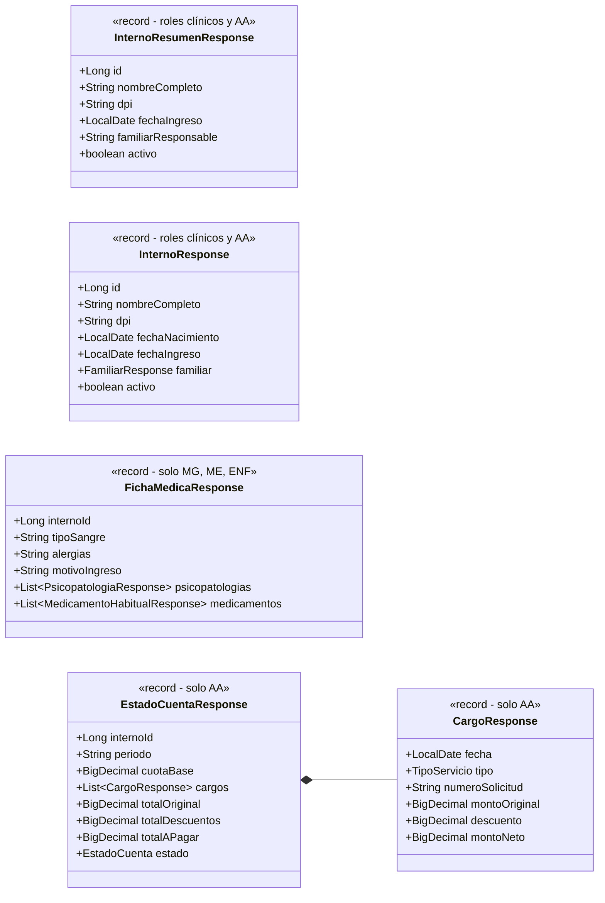

Hay un detalle fácil de pasar por alto. El desglose de la cuenta (HU-18) podría filtrar datos clínicos sin mostrar un solo diagnóstico: una línea que dijera "Consulta de Psiquiatría" o el nombre de un antipsicótico revela el padecimiento del interno. Por eso **`CargoResponse` solo lleva el tipo de servicio (consulta, laboratorio o farmacia), la fecha, el número de solicitud y los montos**, nunca la especialidad, el nombre del examen ni el del medicamento. Si el familiar necesita el detalle clínico, lo solicita al personal médico.

El mismo criterio de mínimo privilegio aplica a los demás roles:

- **Laboratorio:** `OrdenLaboratorioResponse` trae el paciente, el examen, las indicaciones y el médico solicitante, pero no el diagnóstico.
- **Farmacia:** `RecetaResponse` trae los medicamentos, las dosis y las cantidades, pero no el diagnóstico.

Cada endpoint nuevo tiene una prueba automática que verifica, rol por rol, quién recibe 200 y quién 403, igual que la prueba de los siete roles del Sprint 1 (YS-82).

---

## 5. Hallazgos que afectan el backlog

Al diseñar los componentes contra los criterios de aceptación aparecieron tres diferencias. Se registran aquí para corregirlas en Jira antes de implementar las historias afectadas:

1. **Nombres de estado.**
   - HU-13 dice que la orden pasa a "Completada"; el diagrama DE-02 la llama "Resultados Cargados".
   - HU-16 dice que la receta pasa a "Despachada"; el diagrama DE-03 la llama "Entregada".

   El diseño usa los nombres de los diagramas de estados, porque son los que ya definió el análisis y los que usa el Manual de Diseño Visual. Se propone ajustar el texto de las dos historias.
2. **El registro del pago del familiar no tiene historia.** Los pasos 5 a 7 de CU-006 (el familiar paga, el administrador registra el pago y los servicios quedan "Completamente Cancelados") no aparecen en ninguna de las historias HU-18 a HU-23. Sin ellos, la cuenta mensual nunca sale de "Pendiente de Pago". Se resolvió sin una historia nueva: el registro de pagos es la subtarea YS-133 de HU-18, y de ella leen HU-21 (servicios pendientes de cancelar) y los reportes de cobros (HU-26 y HU-27).
3. **La tarifa de consulta no tiene dueño.** HU-14 y HU-17 definen quién registra el costo del laboratorio y de la farmacia, pero ninguna historia dice de dónde sale el costo de la consulta, que HU-18 necesita sumar. El diseño lo resuelve con una tarifa por especialidad (`Especialidad.tarifaConsulta`), administrada por la fundación. **Resuelto el 09/10 en HU-07** con la subtarea YS-169: la Fundación define la tarifa en "Médicos y disponibilidad" y cada visita la copia al iniciarse (`VisitaMedica.costoConsulta`), así que un cambio de tarifa no altera las visitas ya dadas.
